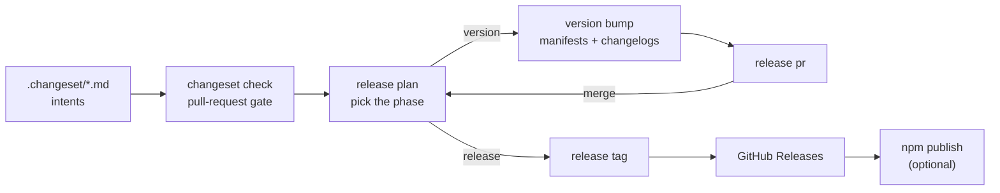

# pnpm-release-management

Release automation for pnpm monorepos. You write a change intent in `.changeset/` with each pull request. On every push to `main`, the reusable workflow versions the packages, opens the release pull request, tags each new version, writes its GitHub Release and, if you turn it on, publishes to npm with no npm token.

Nobody decides _when_ a release runs. Each run works out its phase from what the repository already holds, so a release interrupted halfway resumes on the next push.

## How it works



| Step    | Runs when                                          | Does                                                                                                                                         |
| ------- | -------------------------------------------------- | -------------------------------------------------------------------------------------------------------------------------------------------- |
| version | pending intents exist on `main`                    | bumps every affected version surface, writes each package's changelog, opens or updates the release pull request on `changeset-release/main` |
| release | a merged version has no tag yet                    | pushes the tag and cuts a GitHub Release whose body is that version's changelog                                                              |
| publish | `npm-publish: true` and npm lacks a tagged version | publishes the workspace tarballs to npm through trusted publishing                                                                           |
| none    | nothing is owed                                    | exits                                                                                                                                        |

The changelog is written in the version phase, not rebuilt at release time. The release notes are the text reviewed in the release pull request.

## Quick start

You need three files in the consuming repository: a release workflow, a changeset check and `release.jsonc`.

**1. The release workflow**, `.github/workflows/release.yml`. You keep the trigger and the permissions; the reusable workflow decides the phase.

```yaml
name: Release

on:
  push:
    branches: [main]

permissions:
  contents: write
  pull-requests: write
  actions: write
  id-token: write

jobs:
  release:
    uses: systemfsoftware/pnpm-release-management/.github/workflows/release.yml@main
    with:
      ci-workflow: ci.yml
```

> [!IMPORTANT]
> Grant `id-token: write` even if you never publish to npm. GitHub checks every nested job's permissions before the run starts, so without it each run fails at once with "The nested job 'publish' is requesting 'id-token: write', but is only allowed 'id-token: none'".

**2. The changeset check**, `.github/workflows/changeset-check.yml`. It fails a pull request that changes a publishable package's build without recording an intent.

```yaml
name: Changeset Check

on:
  pull_request:
    types: [opened, synchronize, reopened, ready_for_review]

permissions:
  contents: read
  pull-requests: read

jobs:
  check:
    uses: systemfsoftware/pnpm-release-management/.github/workflows/changeset-check.yml@main
```

**3. The configuration**, `release.jsonc` at the repository root:

```jsonc
{
  "base": "main",
  "branch": "changeset-release/main",
  "versioning": {
    "strategy": "surfaces",
    "manifest": "package.json",
    "changelog": "CHANGELOG.md",
    "surfaces": [
      { "kind": "toml", "header": "[workspace.package]", "glob": "crates/*/Cargo.toml" },
      { "kind": "nix", "path": "nix/version.nix" }
    ]
  },
  "gate": { "strategy": "turbo", "task": "build" },
  "pr": { "title": "chore(release): version packages" }
}
```

`surfaces` lists every file besides `package.json` that carries the version, so a Cargo crate or a Nix derivation moves in step. The `gate` decides which packages need an intent: here, any package whose Turbo `build` hash changed. Every key is in [docs/configuration.md](docs/configuration.md).

Then record an intent with each change, as [docs/change-intents.md](docs/change-intents.md) shows, and merge as usual.

## Publishing to npm

Set `npm-publish: true` on the release job:

```yaml
jobs:
  release:
    uses: systemfsoftware/pnpm-release-management/.github/workflows/release.yml@main
    with:
      ci-workflow: ci.yml
      npm-publish: true
```

Releases then also publish the repository's `.#workspace-tarballs` to npm through [trusted publishing](https://docs.npmjs.com/trusted-publishers), with OIDC and no npm token. Versions npm already holds are skipped. The publish job runs on any push to `main` that is not a version phase, so a version tagged before publishing was turned on still gets published. It always runs on `ubuntu-latest`, because npm accepts trusted publishing only from GitHub-hosted runners.

### Trusting the workflow

Each package must name your repository's release workflow as its trusted publisher on npmjs.com. npm only accepts that for a package that already exists, so a brand-new name needs one publish from a person first. `npm-trust` does both steps for every publishable package in the repositories you name:

```sh
npm login
nix run github:systemfsoftware/pnpm-release-management#npm-trust -- <owner>/<repo> [<owner>/<repo>...]
```

For each public package in the repository's scope it:

1. reserves the name if npm lacks it, publishing `0.0.0-bootstrap.0` under the `bootstrap` dist-tag;
2. trusts the workflow that calls this one, unless that trust already exists.

Run it again whenever a repository adds a package. It needs 2FA on your npm account; npm's trust commands refuse tokens that bypass it. The Nix app brings its own Node.js and npm, so you need neither installed.

## Distribution through Nix

Packages can also be consumed without npm. A producer pushes its tarballs to the binary cache at `https://nix.systemfsoftware.com`, and a consumer substitutes them through its flake inputs, so a package already pushed is fetched rather than built.

Add the cache and take each producer as a flake input:

```nix
{
  nixConfig = {
    extra-substituters = "https://nix.systemfsoftware.com";
    extra-trusted-public-keys = "nix-cache-1:wXA8I4DayNW9q6enUyQA/P/nT38pGSTLt374t3gsn7M=";
  };
  inputs = {
    nixpkgs.follows = "producer/nixpkgs";
    producer.url = "github:systemfsoftware/systemfsoftware/<rev>";
    pnpm-release-management.url = "github:systemfsoftware/pnpm-release-management";
  };
}
```

Then build the producer's tarballs and a pnpm store from your lockfile:

```nix
packages = forEachSystem (pkgs: rec {
  producer-tarballs = pnpm-release-management.lib.mkProducerTarballs {
    inherit pkgs;
    producers = { inherit producer; }; # each: packages.<system>.workspace-tarballs
  };
  pnpm-store = pnpm-release-management.lib.mkPnpmConsumerStore {
    inherit pkgs;
    src = self; # holds package.json, pnpm-lock.yaml, pnpm-workspace.yaml
    files.".deps" = producer-tarballs;
  };
});
```

> [!NOTE]
> Nix applies a flake's `nixConfig` only with `--accept-flake-config`, or for a trusted user.

The dev shell copies the tarballs into `.deps/`, which belongs in `.gitignore`. The `overrides` that point each package at its tarball, the producer side and the update steps are in [docs/distribution.md](docs/distribution.md).

## Documentation

| Document                                         | Covers                                                                       |
| ------------------------------------------------ | ---------------------------------------------------------------------------- |
| [docs/configuration.md](docs/configuration.md)   | `release.jsonc` keys, versioning surfaces, the Turbo gate                    |
| [docs/change-intents.md](docs/change-intents.md) | writing `.changeset/` intents, and the `none` bump                           |
| [docs/commands.md](docs/commands.md)             | every subcommand and its flags                                               |
| [docs/ci.md](docs/ci.md)                         | the two reusable workflows, their inputs and the permissions a caller grants |
| [docs/distribution.md](docs/distribution.md)     | producing and consuming packages through Nix                                 |
| [docs/legacy-tags.md](docs/legacy-tags.md)       | counting releases cut under an earlier tag scheme as released                |
| [docs/sandbox.md](docs/sandbox.md)               | the sandbox that runs dependency code                                        |

## Contributing

Development setup, the checks CI runs and the commit-message rules are in [CONTRIBUTING.md](CONTRIBUTING.md).

## License

Apache-2.0. See [LICENSE](LICENSE).
