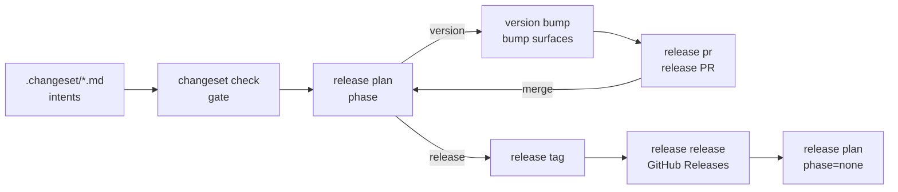

# pnpm-release-management

Release tooling for pnpm monorepos. It turns change intents in `.changeset/` into versioned packages, git tags and GitHub Releases, and runs from the repository's own state on every push. A consuming repository keeps its `release.jsonc`, its `.changeset/` intents and its manifests, and deletes its own copies of the tools.

## What it does

The pipeline has one job: turn authored change intents into versioned, tagged
packages and GitHub Releases without a human deciding _when_ anything runs. Every
phase is derived from durable repository state, never from a pull-request ref,
so a half-finished release resumes on the next push.



`version bump` also writes the per-package changelog that later becomes the
GitHub Release body, which is why the order matters: the release notes are
authored with the version bump, not reconstructed at release time.

https://nix.systemfsoftware.com is the package registry for `@systemfsoftware`
packages: a producer pushes its package tarballs there from `main`, a consumer
substitutes them through its flake inputs, and nothing is published to npm. See
[Distribution through Nix](#distribution-through-nix).

## Quick start

Add a caller to the consuming repository. The trigger and the permissions stay
with you; the phase decision stays in the reusable workflow.

`.github/workflows/release.yml`:

```yaml
name: Release

on:
  push:
    branches: [main]

permissions:
  contents: write
  pull-requests: write
  actions: write

jobs:
  release:
    uses: systemfsoftware/pnpm-release-management/.github/workflows/release.yml@main
    with:
      ci-workflow: ci.yml
```

`.github/workflows/changeset-check.yml`:

```yaml
name: Changeset Check

on:
  pull_request:
    types: [opened, synchronize, reopened, ready_for_review]

permissions:
  contents: read
  pull-requests: read

jobs:
  check:
    uses: systemfsoftware/pnpm-release-management/.github/workflows/changeset-check.yml@main
```

Then add a `release.jsonc`:

```jsonc
{
  "base": "main",
  "branch": "changeset-release/main",
  "versioning": {
    "strategy": "surfaces",
    "manifest": "package.json",
    "changelog": "CHANGELOG.md",
    "surfaces": [
      { "kind": "toml", "header": "[workspace.package]", "glob": "crates/*/Cargo.toml" },
      { "kind": "nix", "path": "nix/version.nix" }
    ]
  },
  "gate": { "strategy": "turbo", "task": "build" },
  "pr": { "title": "chore(release): version packages" }
}
```

## Distribution through Nix

`@systemfsoftware` packages are not on npm. A producer pushes its tarballs to `nix.systemfsoftware.com`, and a consumer substitutes them through its flake inputs, so a package its producer has pushed is fetched rather than built. Nix applies a flake's `nixConfig` only with `--accept-flake-config` or for a trusted user.

Set the registry as a substituter and take each producer as a flake input:

```nix
{
  nixConfig = {
    extra-substituters = "https://nix.systemfsoftware.com";
    extra-trusted-public-keys = "nix-cache-1:wXA8I4DayNW9q6enUyQA/P/nT38pGSTLt374t3gsn7M=";
  };
  inputs = {
    nixpkgs.follows = "producer/nixpkgs";
    producer.url = "github:systemfsoftware/systemfsoftware/<rev>";
    pnpm-release-management.url = "github:systemfsoftware/pnpm-release-management";
  };
}
```

Then build the producer's tarballs and a pnpm store from your lockfile:

```nix
packages = forEachSystem (pkgs: rec {
  producer-tarballs = pnpm-release-management.lib.mkProducerTarballs {
    inherit pkgs;
    producers = { inherit producer; }; # each: packages.<system>.workspace-tarballs
  };
  pnpm-store = pnpm-release-management.lib.mkPnpmConsumerStore {
    inherit pkgs;
    src = self; # holds package.json, pnpm-lock.yaml, pnpm-workspace.yaml
    files.".deps" = producer-tarballs;
  };
});
```

The dev shell copies the tarballs into `.deps/`, which goes in `.gitignore`. The `overrides` block that points each `@systemfsoftware` entry at its tarball, the producer side, and the update steps are in [docs/distribution.md](docs/distribution.md).

## Documentation

| Document                                         | Covers                                                                       |
| ------------------------------------------------ | ---------------------------------------------------------------------------- |
| [docs/configuration.md](docs/configuration.md)   | `release.jsonc` keys, versioning surfaces, the Turbo gate                    |
| [docs/change-intents.md](docs/change-intents.md) | Writing `.changeset/` intents and the `none` bump                            |
| [docs/commands.md](docs/commands.md)             | Every app subcommand and its flags                                           |
| [docs/ci.md](docs/ci.md)                         | The two reusable workflows, their inputs and the permissions a caller grants |
| [docs/distribution.md](docs/distribution.md)     | Producing and consuming packages through Nix                                 |
| [docs/legacy-tags.md](docs/legacy-tags.md)       | Counting releases cut under an earlier tag scheme as released                |
| [docs/sandbox.md](docs/sandbox.md)               | The sandbox that runs dependency code                                        |
| [CONTRIBUTING.md](CONTRIBUTING.md)               | Dev shell, checks, commit messages, adding a subcommand, the end-to-end test |

## Contributing

Development setup, the checks CI runs and the commit-message contract are in [CONTRIBUTING.md](CONTRIBUTING.md).

## License

Apache-2.0. See [LICENSE](LICENSE).
