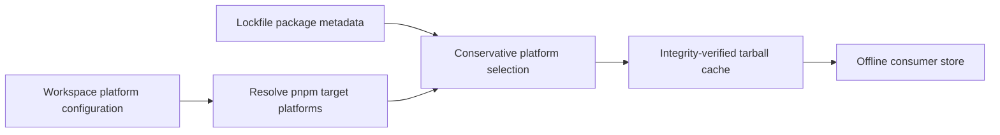

# Platform-Aware pnpm Consumer Store - Plan

## Goal Capsule

- **Objective:** Consumer CI can install its dependencies offline without exhausting runner storage on packages for platforms it does not support.
- **Means:** Select registry fetches using the consumer's pnpm platform configuration (KTD1).
- **Authority:** The request and repository rules take precedence over this plan.
- **Stop conditions:** Obtain driver approval before implementation. Stop if offline installation needs an excluded package, if platform semantics cannot be established safely, or if the solution requires a protected workflow change.
- **Ownership:** The implementer ships the shared-library change; the consumer owner updates its pin and CI supplies the end-to-end result.

---

## Product Contract

### Summary

Make the shared consumer-store builder respect the platforms a workspace asks pnpm to install while retaining its existing offline and integrity guarantees.

### Problem Frame

The current lockfile reader records each registry package without using its platform restrictions. Its cache fetches incompatible platform archives before pnpm can decide which packages to install. This consumes runner storage even where those archives cannot be used.

The affected consumer's measurements and runner evidence are retained outside this public repository. They justified prioritizing registry filtering over changing another workspace's source tree.

### Requirements

**Store selection**

- R1. Select fetches using the consumer's `supportedArchitectures` and each lockfile package's `os`, `cpu`, and `libc` restrictions.
- R2. Preserve every package pnpm needs to install for each selected platform, including the current platform where pnpm semantics require it.
- R3. Preserve integrity verification, workspace-local tarballs, missing-resolution failures, and evaluation without import-from-derivation.
- R4. Keep callers without usable explicit platform information safe from missing offline dependencies.

**Delivery**

- R5. Verify the existing delivery checks and sandbox proofs in the development environment, subject to local execution restrictions.
- R6. Have the consumer update its shared-library pin and use its existing CI check as the end-to-end proof.

### Scope Boundaries

- No additional tests, checks, gates, or workflows. Exercise the specified edge cases with existing suites and temporary local probes only.
- Do not edit the other workspace or its vendored reference trees.
- No free-disk steps, larger runners, `continue-on-error`, or narrowed checks without explicit approval for that change.
- Do not read credentials, call Doppler, edit `bin/` wrappers, use `--no-verify`, or enable `nix-command`.
- Local e2e, journey, Playwright, and full-gate suites are prohibited by OP28 and run in CI.

---

## Planning Contract

### Key Technical Decisions

- KTD1. **Filter before creating fixed-output fetches.** Extend the existing lockfile and store path rather than deleting fetched data afterward. This addresses the source of the disk footprint. (session-settled: user-directed — chosen over changing the other workspace's source tree: measured excluded archives were the larger footprint.)
- KTD2. **Follow pnpm's platform semantics conservatively.** Resolve `current` against the target host, apply restrictions across all configured axes, and retain packages whenever an absent or unsupported configuration cannot be interpreted safely. Do not assume package names encode platform or drop unrestricted entries. See [pnpm supportedArchitectures](https://pnpm.io/settings/dependency-resolution#supportedarchitectures).
- KTD3. **Keep evaluation pure.** Obtain the workspace configuration from an evaluation-readable source. Where `src` is a derivation, accept a separately supplied workspace file or equivalent pure input rather than reading a derivation output at evaluation time. Ensure consumer wiring supplies that input when needed.
- KTD4. **Preserve the consumer contract.** The store must contain the union of packages for all requested platforms, not only the machine doing the build. Existing pnpm environment-document exclusions, `file:` handling, and integrity checks remain unchanged.

### Impact and Risks

`lib.mkPnpmConsumerStore` is a shared flake API. Changes to `nix/lib/pnpm-store.nix` also affect workspace-package stores through `nix/lib/pnpm-workspace-packages.nix`. Changes to `nix/lib/pnpm-lock.nix` affect the existing parser check in `flake.nix`. A host-only filter could silently omit a configured second architecture; an overbroad filter could hide malformed lockfile entries. Validate existing error paths before filtering.

An excluded archive's uncompressed payload is not the same as disk pnpm actually consumes: pnpm may never unpack it. Reduced fetch bytes are evidence of a smaller potential footprint, not proof that the downstream check will fit. CI must establish that outcome.

### Flow

---

## Implementation Units

### U1. Select compatible registry archives

**Goal:** Prevent fetches for entries incompatible with every platform pnpm is configured to install.

**Requirements:** R1–R4. **Dependencies:** Driver approval.

**Files:** `nix/lib/pnpm-lock.nix`, `nix/lib/pnpm-store.nix`, `flake.nix`, `nix/lib/pnpm-workspace-packages.nix`, `README.md`. Existing verification locations: `flake.nix` (`pnpm-lock-parser`) and `nix/sandbox/proofs.nix`.

**Approach:** Extend the existing parser to retain platform metadata alongside resolutions, then pass a pure workspace platform input through store construction. Validate resolution errors before selection. Map target platforms and pnpm's `current` semantics without introducing an import-from-derivation. Preserve existing caller behavior where platform configuration cannot be interpreted safely. Update public API documentation to explain input, defaults, and selected-platform guarantees.

**Execution note:** Use temporary, uncommitted probes to exercise the consumer-visible cases below; do not add permanent tests or checks.

**Scenarios:**

- A workspace selecting Linux x64 and arm64 retains matching packages for both architectures and excludes incompatible operating systems and libc variants.
- Packages with no platform restrictions remain available, and entries with local tarballs remain handled by the existing local-file path.
- A `current` value resolves to the host platform; absent, negative, or unfamiliar constraints cannot cause an unsafe omission.
- An entry without a resolution still fails at evaluation, even when its platform is excluded; an integrity mismatch still fails verification.
- A workspace with no explicit platform configuration retains the packages needed by its normal offline install.
- A caller whose `src` is a derivation can supply evaluation-readable workspace configuration without triggering import-from-derivation.

**Verification:** Existing parser checks and sandbox proofs pass; an offline install succeeds for configured platforms using only the resulting store, and the excluded registry fetches are absent. Exercise both x64 and arm64 selection, using native CI for execution where cross-platform binaries cannot run locally.

### U2. Deliver and hand off the pin

**Goal:** Make the shared fix available to consumers and obtain the actual runner result.

**Requirements:** R5–R6. **Dependencies:** U1.

**Files:** `README.md`; downstream consumer flake and lockfile, owned outside this repository.

**Approach:** Complete the repository's normal release and documentation requirements. After the shared change is available, the consumer owner updates its direct shared-library input and lockfile; followed inputs must resolve to that same revision. If the consumer uses a derivation-backed source that needs a separate workspace file, update its existing flake call accordingly. Keep its existing CI check unchanged.

**Verification:** The consumer's unchanged CI check completes on its GitHub-hosted runner after the re-pin. If it still runs out of space, report the actual result and stop rather than weakening the check.

---

## Verification Contract

After approval, inside `nix develop`, run the repository's applicable format, lint, typecheck, unit, and property checks, plus the existing parser and sandbox proofs from `.github/workflows/sandbox.yml`. Confirm the tampered-integrity proof still fails for a hash mismatch. Exercise an actual network-isolated install using the resulting store. Do not enable `nix-command`; if the environment cannot run an existing proof under that constraint, report the exact blocker rather than changing configuration.

Run repository build and full delivery gates in CI where OP28 prohibits them locally. CI also owns all e2e, journey, and Playwright suites. No full local gate, new test, or narrowed check substitutes for CI. The consumer re-pin and its existing GitHub-hosted check are the end-to-end proof.

---

## Definition of Done

- The selected platforms install offline and incompatible platform archives are not fetched.
- Existing local-eligible checks and sandbox proofs pass, or an actual environment blocker is reported with its command and output.
- Public API documentation reflects the implemented behavior; temporary probes and abandoned code are removed.
- The consumer has re-pinned the released shared revision and its existing CI check is green. Until then, the downstream outcome remains unverified.
