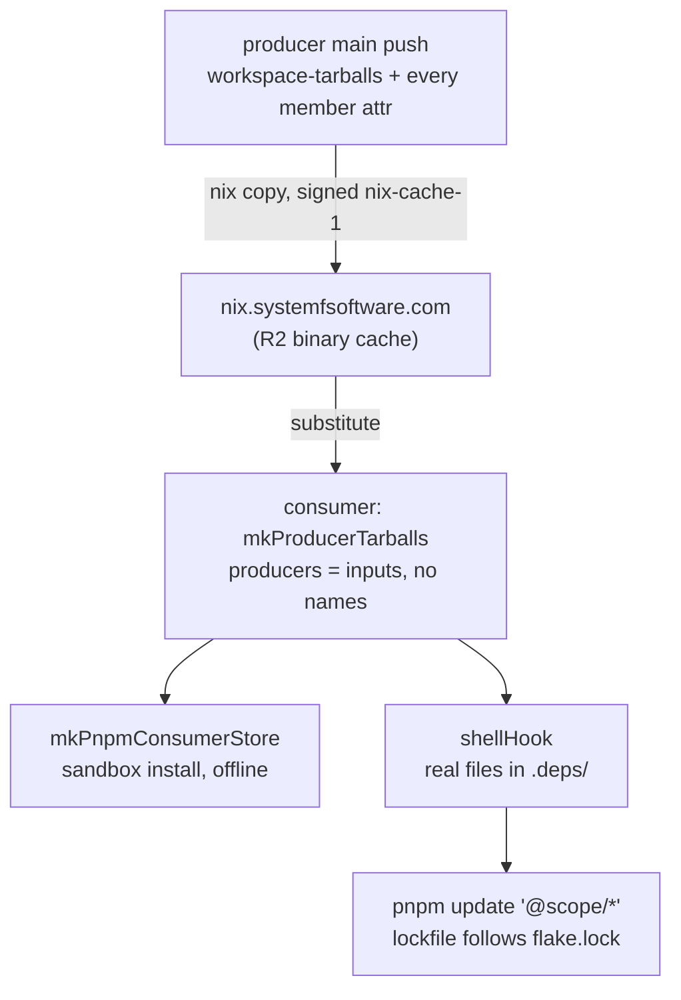

# nix.systemfsoftware.com as the Package Registry (SYS-1296) - Plan

**Target repo:** pnpm-release-management (units U1, U2), then the repositories in the Appendix (units U3 onward).

## Goal Capsule

- **Objective:** A repository that uses `@systemfsoftware` packages gets them from nix.systemfsoftware.com without building them locally and without its own copy-and-override scripts, and its docs state in one sentence that nix.systemfsoftware.com is the package registry.
- **Means:** Producers push their package tarballs to the cache from `main`; consumers take producers as flake inputs through `lib.mkProducerTarballs` and `lib.mkPnpmConsumerStore` (KTD1, KTD2).
- **Authority:** Linear SYS-1296 and the request override this plan. Repository rules in `AGENTS.md` apply to every unit.
- **Stop conditions:** Do not start a consumer unit (U5 onward) until its producers pass the cache-hit check in U3. Stop and report if a producer's pushed store paths differ from the paths a consumer evaluates (see Open Questions).
- **Ownership:** U1 and U2 ship in this repository's PR. Each later unit is one pull request in the repository it names.

---

## Product Contract

### Summary

Replace the `.sfs-deps` machinery in 20 repositories with one documented consumer route in pnpm-release-management. Add what that route lacks, so a consumer lists no package by name in `flake.nix` and keeps no copy script. Rewrite the distribution text in every affected repository around one sentence: nix.systemfsoftware.com is the package registry for `@systemfsoftware` packages.

### Problem Frame

Each consumer pins a producer flake, builds its tarballs itself into `.sfs-deps/`, and hand-keeps a `file:.sfs-deps/<name>-<version>.tgz` override for every package. Nine repositories carry the same 70-line `flake.nix` block with a hand-listed name array. Four repositories carry a shell loop that copies `workspace-tarballs`. Others build producer versions from source (`xstate`, `frontend`), vendor tarballs into git (`agent-inbox`, `turbo-remote-cache`), or ship a TypeScript tool and two composite actions (`systemfsoftware`, `younna-ai`).

The documented route already exists in this repository: `lib.mkPnpmWorkspacePackages` on the producer, `lib.mkPnpmConsumerStore` on the consumer. It still leaves four things to each consumer, and all four are the per-repository code the ruling removes.

- The producer's package names, listed by hand in `flake.nix` (for example `flake.nix:18-21` in `effect-daemon`).
- A version in every `file:` path, so a producer bump edits `pnpm-workspace.yaml`.
- A copy step that puts real files under `.sfs-deps/` for the sandbox (`scripts/sfs-deps` in `younna-ai`, `cp -L` in nine `AGENTS.md` files).
- A rule for a package two producers both ship (`flake.nix:55-71` in `younna-ai`).

The cache side is not ready either. At `5836bb12` (systemfsoftware #927) the push workflow succeeded, yet none of the 31 store paths a consumer's evaluation computes for core's `workspace-tarballs` and per-package outputs is in the cache (narinfo 404 for all 31). The push job's x86_64 log builds `systemfsoftware-tarballs-0.drv` as `m6a56hci…`; a consumer pinning `github:systemfsoftware/systemfsoftware/5836bb12` evaluates `p9iv9w49…`. The push set also lists 24 names by hand and omits six public members: `effect-atom`, `effect-atom-react`, `omp-typescript-discipline`, `storybook-gherkin`, `trace-spec`, `trace-taxonomy`.

### Requirements

**Registry contract**

- R1. A producer's `main` push builds `packages.<system>.workspace-tarballs` and `packages.<system>.<attr>` for every public member, on each supported system, signed by `nix-cache-1`. The push set comes from `workspace-tarballs.members`, not a hand-kept list, and is built from the flake reference consumers pin (`github:<owner>/<repo>/<rev>`).
- R2. A consumer takes each producer as a flake input pinned by `flake.lock` and substitutes its tarballs from https://nix.systemfsoftware.com with key `nix-cache-1:wXA8I4DayNW9q6enUyQA/P/nT38pGSTLt374t3gsn7M=`. A cold install builds no producer derivation (`nix build --dry-run` lists none), which holds only when the store path the consumer evaluates for each producer is the path that producer pushed.
- R3. Consumers use `lib.mkProducerTarballs` and `lib.mkPnpmConsumerStore`. `bin/sfs-deps`, hand-built linkFarms, hand-listed names, `file:.sfs-deps/<name>-<version>.tgz` overrides, `sfs-deps` CI steps and anything that only fed them are deleted.
- R4. Nothing is published to npm.

**pnpm-release-management**

- R5. `lib.mkProducerTarballs` takes producer flake inputs whole and names no package. It lays one version-free `<name>.tgz` per public member, an `index.json`, an `overrides` block of `<name>@*` entries for `pnpm-workspace.yaml` (so a consumer workspace member of the same name stays linked), and a `shellHook` that copies real files into the consumer's `.deps/`. A package two producers ship is an error unless `precedence` orders them.
- R6. The README says, in one sentence, that nix.systemfsoftware.com is the package registry for `@systemfsoftware` packages: producers push package tarballs there from `main`, consumers substitute them through flake inputs, and nothing goes to npm. "Nothing is published to a registry" and "Distribution through Nix" are rewritten around it. The consumer section shows `https://nix.systemfsoftware.com` and the `nix-cache-1` key beside the flake input.
- R7. Text that only existed for the old route is deleted from this repository: no `.sfs-deps` reference remains.
- R8. A changeset intent accompanies any moved publishable package. This change moves none.

**Documentation**

- R9. In each repository the README, AGENTS.md and CONTRIBUTING.md lines named in the Appendix are rewritten the same way: the R6 sentence where distribution is described, no `.sfs-deps` instruction, no `npm install @systemfsoftware/...` as an install route.

### Scope Boundaries

**Deferred to Follow-Up Work**

- This repository's own `devDependencies` `@systemfsoftware/all@1.1.3` and `@systemfsoftware/tsconfig@1.3.3` resolve from npm (`pnpm-lock.yaml:26-31`, `:1602`, `:1680`). It has no `.sfs-deps`, so SYS-1296 does not list it. Moving them to the registry route is a separate change.
- The producer `nix-cache-push` workflow for pnpm-release-management is SYS-1260's producer PR, in flight.
- Dependabot's `nix` ecosystem bumps only `flake.lock` in `frontend`, `effect-endgame-starter-kit`, `polymarket-bot`, `stryker-js-effect`, `xstate`, `systemfsoftware` and `are-the-types-wrong-effect`. After KTD2, each such bump fails a cold frozen install until `pnpm update '@systemfsoftware/*'` runs. Whether to pair the bump with an automatic lockfile update or exclude producer inputs from Dependabot is an owner choice; see Open Questions.

**Accepted consequence of the ruling**

- R4 and R9 leave a reader who does not use Nix with no install route for `@systemfsoftware` packages: the registry serves Nix store paths, and the npm copies are stale (`effect-daemon/README.md:22`). The README states the flake route as the only one.

**Considered and not built**

- A flake check in each consumer that compares `overrides` with `pnpm-workspace.yaml`. The generated block is pasted once and changes only when a producer adds or drops a package. A wrong-version override fails the frozen install, but a missing one installs a stale npm copy and stays green, so U5-U9 check the lockfile for it directly instead (Verification Contract). Evidence that would change the call: a missing override reaches a consumer's `main`.
- A configurable tarball directory (`dir`) and a consumer-side `exclude` list on `mkProducerTarballs`. Every consumer uses `.deps`, and `<name>@*` keeps a same-named workspace member linked (checked on pnpm 12.9.0). Evidence that would change the call: a consumer cannot use `.deps`, or a producer's copy of a consumer-owned package is installed through a range.
- A `pnpmfile` that rewrites `@systemfsoftware/*` dependencies. It adds a lockfile-checked script per repository, which is the code this plan removes.

---

## Planning Contract

### Key Technical Decisions

- KTD1. **Take producers whole, by flake input.** `lib.mkProducerTarballs { pkgs; producers; precedence? }` reads each producer's `packages.<system>.workspace-tarballs.members`, so no name is listed. It substitutes `workspace-tarballs`, one store path per producer and system; per-package outputs are pushed too (R1) for consumers that pick one. Rejected: picking per-package outputs by name, which is the old `sfsPackages` array.
- KTD2. **File names carry no version.** Each tarball is `<attr>.tgz`. `stryker-js-effect` already does this (`flake.nix:47-58`, "the `file:` paths keep their spelling across releases; only their integrity moves"). Checked on pnpm 12.9.0: with `file:.deps/foo.tgz` and a changed tarball, a cold `pnpm install --frozen-lockfile` fails with `ERR_PNPM_TARBALL_INTEGRITY`, and `pnpm update '@scope/*'` rewrites `version` and `integrity`. A plain `pnpm install` over an existing `node_modules` reports the lockfile up to date and keeps the old files, so the README says the failure is for a cold install.
- KTD3. **The dev shell copies real files.** The sandbox reads no store path outside its closure; `nix/sandbox/proofs.sh:130-132` copies the tarball for that reason. A symlink `.deps -> /nix/store/...` resolves for pnpm (checked) but not inside the sandbox. `shellHook` replaces `*.tgz` and `index.json` under `.deps/` of the git root of the directory the shell is entered from, never the directory itself; it is entered from the consumer's checkout.
- KTD4. **A name clash is an error.** `younna-ai` resolves a name two inputs ship to the earlier one (`flake.nix:55-71`), and `frontend` and core both ship `effect-atom`. `precedence` makes that choice explicit; without it evaluation names the attribute and both producers. A producer member the consumer's own workspace also ships is not a clash between producers: `frontend` ships `effect-atom` 6.0.0 and core ships 6.0.5. The `<name>@*` overrides (KTD7) leave the consumer's workspace link in place and the producer's tarball sits unused in `.deps/`.
- KTD5. **The push set is derived and built from the pinned reference.** `nix eval --json .#workspace-tarballs.members --apply 'map (m: m.attr)'` lists it. A consumer substitutes the path its own evaluation computes; building from `github:<owner>/<repo>/<rev>` makes both sides evaluate the same source. This is a precaution: the cause of the core mismatch is open (Open Questions).
- KTD7. **A producer input carries no `follows`, and overrides are `<name>@*`.** `workspace-tarballs` is a `stdenvNoCC.mkDerivation` with no fixed output hash, so its store path depends on the nixpkgs and the `pnpm-release-management` it is evaluated with. `billing` follows its own `pnpm-release-management` (locked `aaba9ed0`) inside its core input, while core pins `b9b4a1d4`; the library differs, so the path differs and core builds locally. The consumer follows one producer instead (`nixpkgs.follows = "producer/nixpkgs"`, as the nine core-only consumers already do); a second producer keeps its own inputs. The `@*` form is the one `stryker-js-effect` already uses (`pnpm-workspace.yaml:84-87`): on pnpm 12.9.0 a bare-name override replaced a same-named workspace member's `workspace:^` link with the tarball, and `name@*` kept the link.
- KTD6. **Migrate in dependency order.** Producers push, then core's reusable workflows stop requiring `.#sfs-deps`, then consumers repin. Nine consumers call core's reusable checks at a pinned commit, and those workflows take `sfs-deps-installable` (default `.#sfs-deps`, `.github/AGENTS.md:80,97,107`).

### High-Level Technical Design

### Assumptions

- The nix-cache Worker serves a pushed path at `GET /<hash>.narinfo` and needs no change (`nix-cache/README.md:23-24`).
- Every producer already exposes `workspace-tarballs` through `mkPnpmWorkspacePackages`, except `are-the-types-wrong-effect`, which builds only `attw` (`flake.nix:24-31`).
- `stryker-js-effect`'s `@systemfsoftware/stryker-js-vm-runner@npm:@systemfsoftware/stryker-js-vitest-runner@^10.0.0` override matches an `npm:` alias by its full spec (`pnpm-workspace.yaml:105`); it stays a hand-written line after the generated block.
- Overriding every producer package is required: a producer's packed tarballs name each other by exact version, so an un-overridden package is looked up on npm (`turbo-remote-cache/CLOSURE.md:124` records this happening today).

### Risks and Dependencies

| Risk                                                                                             | Evidence                                                                                                                                          | Mitigation                                                                                                                                                                                                                 |
| ------------------------------------------------------------------------------------------------ | ------------------------------------------------------------------------------------------------------------------------------------------------- | -------------------------------------------------------------------------------------------------------------------------------------------------------------------------------------------------------------------------- |
| Core's pushed paths are not the paths a consumer computes, so every consumer builds core locally | 31 of 31 narinfo requests 404; drv `m6a56hci…` (push log) vs `p9iv9w49…` (consumer eval)                                                          | U3 gates every consumer unit on a narinfo check of the pinned reference's paths                                                                                                                                            |
| Push set omits members                                                                           | six core members missing from `PUSH_SET` (`nix-cache-push.yml:13-42`)                                                                             | R1: derive the set from `members`                                                                                                                                                                                          |
| Two pins of one producer in one consumer                                                         | `frontend` and `xstate` pin core at two commits (`systemfsoftware-effect-cell-types-7`, `flake = false`)                                          | The second pin is retired, not made a named producer: a `flake = false` input has no `packages.<system>`, and version-free names allow one `effect-cell-types.tgz` per consumer (Open Questions)                           |
| A consumer's `follows` inside a producer input changes the producer's store path                 | `billing` follows its own `pnpm-release-management` (`aaba9ed0`) inside core, core pins `b9b4a1d4` (KTD7)                                         | No `follows` inside producer inputs; U5-U8 check the path the consumer evaluates for each producer returns narinfo 200                                                                                                     |
| Release-commit pins predate the push workflow                                                    | `api-extractor-effect` pins `stryker-published` 27b1075, `stryker-js-effect` b118280, all four attw consumers d43a802                             | U3 pushes `github:<repo>/<rev>#workspace-tarballs` once for every release commit a consumer pins, then checks narinfo                                                                                                      |
| `workspace-tarballs` exceeds the cache's per-object cap                                          | `nix-cache/README.md:43-47`: a compressed NAR over 100 MB is refused (413) and blocks every path that references it; `.tgz` files barely compress | U3's narinfo check fails the push job on a miss; if a producer exceeds the cap, `mkProducerTarballs` links per-package outputs instead of `workspace-tarballs` (one line in `producer-tarballs.nix`). Sizes are unmeasured |
| A missing override installs a stale npm copy                                                     | `@systemfsoftware` packages exist on npm at older versions (`effect-daemon/README.md:22`)                                                         | U5-U9 assert no `@systemfsoftware/*` lockfile entry resolves from `registry.npmjs.org`; U11 repeats it org-wide                                                                                                            |
| Flake `nixConfig` ignored                                                                        | Nix prints `ignoring untrusted flake configuration setting 'extra-substituters'` without `--accept-flake-config`                                  | README and each consumer's CI set the substituter in `nix.conf` / `extra_nix_config` as well                                                                                                                               |
| Stale `.deps/` after a producer bump                                                             | plain `pnpm install` keeps old files over an existing `node_modules` (checked)                                                                    | `shellHook` re-copies on entry; README documents `pnpm update '@scope/*'`                                                                                                                                                  |
| A producer without `workspace-tarballs`                                                          | `are-the-types-wrong-effect` builds only `attw`; `api-extractor-effect`, `frontend`, `xstate` consume it                                          | U3 gives it `workspace-tarballs`, built from core's tarballs through this route, before U6 and U7                                                                                                                          |

### Open Questions

**Blocking for U3 onward**

- Why does the push job's checkout evaluate `systemfsoftware-tarballs-0.drv` differently from `github:systemfsoftware/systemfsoftware/5836bb12`? A local `git+file` clone and the GitHub fetch give the same source path (`xmh81…-source`); the push log unpacks `dxvlhpd…-source`. The cause is not established. U3's first step compares the `narHash` of the push job's checkout with `nix flake metadata github:systemfsoftware/systemfsoftware/<rev>`, then checks narinfo for the pinned reference's outputs after one push built from that reference. One candidate: core's `.gitattributes:3` marks `/repos/worktrunk-scripts/CONSTITUTION-ARTICLES.md` `export-ignore`, which a GitHub archive fetch applies and a checkout may not.
- Does `are-the-types-wrong-effect` build offline from core's tarballs? Its lockfile wants `effect-cell-types ^10.1.0` (`pnpm-workspace.yaml:19`), while `frontend` and `xstate` build `attw` from source against `effect-cell-types` 7 because attw 4.2.0 resolves 7. Blocking for U6 and U7. Default: retire the cell-types-7 pin, take `attw` from `are-the-types-wrong-effect`'s `workspace-tarballs`, and prove it by running each consumer's `attw` script against the single core `effect-cell-types`; if it fails, `attw` stays a from-source output of `are-the-types-wrong-effect` itself and consumers take it as a package.

**Deferred**

- How Dependabot `flake.lock` bumps of producer inputs get their lockfile update (Scope Boundaries). The owner chooses between a workflow that runs `pnpm update '@systemfsoftware/*'` on the bump and excluding producer inputs from Dependabot.

---

## Implementation Units

| U-ID | Title                                        | Files touched                                                  | Depends on |
| ---- | -------------------------------------------- | -------------------------------------------------------------- | ---------- |
| U1   | `lib.mkProducerTarballs`                     | `nix/lib/producer-tarballs.nix`, `flake.nix`, fixture          | none       |
| U2   | README: registry sentence and consumer route | `README.md`, `nix/lib/pnpm-store.nix`                          | U1         |
| U3   | Producers push the full tarball set          | each producer's `.github/workflows/nix-cache-push.yml`         | U1         |
| U4   | Core stops requiring `.#sfs-deps`            | `systemfsoftware` reusable workflows, actions, `scripts/tools` | U3         |
| U5   | Nine core-only consumers                     | `flake.nix`, `pnpm-workspace.yaml`, docs                       | U1, U3, U4 |
| U6   | Four multi-producer consumers                | `flake.nix`, `package.json`, `pnpm-workspace.yaml`, actions    | U1, U3, U4 |
| U7   | Consumers that are also producers            | `api-extractor-effect`, `stryker-js-effect`, `xstate`          | U1, U3, U4 |
| U8   | `younna-ai`                                  | flake, `tooling/lockfile`, actions, Dockerfile                 | U5, U6, U7 |
| U9   | Vendored-tarball repositories                | `agent-inbox`, `turbo-remote-cache`                            | U1, U3     |
| U10  | Docs-only repositories                       | `nix-cache`, `comment-checker`, `omp-claude-compat`            | U2         |
| U11  | Sweep                                        | org-wide search                                                | U5-U10     |

### U1. `lib.mkProducerTarballs`

**Goal:** A consumer takes producer flake inputs whole and gets version-free tarballs, an index, the overrides block and a copy hook, with no package named.

**Requirements:** R3, R5, R7.

**Dependencies:** none.

**Files:**

- `nix/lib/producer-tarballs.nix` (new)
- `flake.nix` (export `lib.mkProducerTarballs`; checks `producer-tarballs`, `producer-consumer-store`)
- `nix/lib/fixtures/producer-consumer/package.json`, `pnpm-workspace.yaml`, `pnpm-lock.yaml` (new)

**Approach:**

1. For each producer, read `packages.<system>.workspace-tarballs.members` and link `<attr>.tgz` to `${workspace-tarballs}/<tarball>`.
2. Order by `precedence`, or by name when none is given; without `precedence` a repeated attribute fails evaluation naming the producers.
3. Expose `overrides` as one `"<name>@*": file:.deps/<attr>.tgz` entry per package (KTD7), and `shellHook` as attributes of the output. The hook removes only `*.tgz` and `index.json` under `.deps/`.

**Patterns to follow:** `lib.mkPnpmConsumerStore` in `flake.nix`; `publishedOf` in `stryker-js-effect/flake.nix`.

**Test scenarios:**

- One real producer (`nix/lib/fixtures/file-deps`): the output lists `app.tgz` and `index.json`, the index is `[{ file: "app.tgz", name: "@fixture/app" }]`, and `app.tgz` is byte-equal to the producer's `app-1.0.0.tgz`.
- Two producers shipping `app` without `precedence`: evaluation fails.
- The same two with `precedence = [ "real" "other" ]` and with the order reversed: the first producer's `app` wins; `lib` appears once.
- `overrides` for one producer is `"@fixture/app@*": file:.deps/app.tgz`; a consumer workspace member named like a producer package, depended on by `workspace:^`, stays a `link:` (checked once on pnpm 12.9.0; not a permanent test, since it exercises pnpm and not this library).
- The hook run over a `.deps/` holding `old.tgz`: `app.tgz` is a regular file, `old.tgz` is gone, `index.json` is present.
- A consumer fixture whose lockfile names `file:.deps/tiny-lib.tgz` builds its store with `files.".deps"` from the output; the fixture's `pnpm-workspace.yaml` equals `overrides:` plus the generated block.

**Verification:** `nix build .#checks.<system>.producer-tarballs .#checks.<system>.producer-consumer-store` succeeds.

### U2. README: registry sentence and consumer route

**Goal:** A reader cannot misread where `@systemfsoftware` packages come from.

**Requirements:** R6, R7.

**Dependencies:** U1.

**Files:** `README.md`, `nix/lib/pnpm-store.nix` (comment).

**Approach:**

1. Replace "Nothing is published to a registry" and the opening of "Distribution through Nix" with the R6 sentence.
2. Split "Distribution through Nix" into "Produce" (existing builder text plus the push set) and "Take a producer's packages" (substituter and key beside the flake input, `mkProducerTarballs`, overrides, shell hook, version move, dry-run check).
3. Say "npm registry" wherever the text means npm, so "registry" alone means nix.systemfsoftware.com.
4. Rewrite "Release identity" so it no longer says nothing is pushed to a registry.

**Test expectation:** none -- prose; `./bin/dprint check` covers layout.

**Verification:** the R6 sentence appears twice, verbatim; `git grep -nI sfs-deps -- . ':!*.lock' ':!docs/plans/*'` returns exit 1.

### U3. Producers push the full tarball set

**Goal:** For every producer, a green `main` run leaves its `workspace-tarballs` and every member output in the cache under the paths a consumer computes.

**Requirements:** R1, R4.

**Dependencies:** U1 (documents the push set).

**Files:** `.github/workflows/nix-cache-push.yml` in each producer (Appendix lists which have none).

**Approach:**

1. Settle the Open Question on core's source mismatch first: compare the push job's checkout `narHash` with the GitHub reference's, and test the `export-ignore` candidate.
2. Replace `PUSH_SET` with a step that evaluates `members` and builds `workspace-tarballs` plus each member attr.
3. Build from `github:${GITHUB_REPOSITORY}/${GITHUB_SHA}#packages.<system>.<attr>` (KTD5).
4. After the push, check `https://nix.systemfsoftware.com/<hash>.narinfo` for each pushed path and fail the job on a miss.
5. For every release commit a consumer pins as a producer (`stryker-published` 27b1075 and b118280, `are-the-types-wrong-effect` d43a802), push `github:<repo>/<rev>#workspace-tarballs` once and check narinfo; those commits predate the workflow.
6. Give `are-the-types-wrong-effect` a `workspace-tarballs` output. It is a consumer of core as well: its lockfile resolves `@systemfsoftware/*` from npm, so it takes core through `mkProducerTarballs` first, and the Open Question on `effect-cell-types` 7 decides what `attw` builds against.

**Test scenarios:**

- A producer with a member added after the workflow was written: the member is in the next push without a workflow edit.
- A push where one member fails to build: the job fails and names the member (the existing step already does this).
- A pushed path missing from the cache: the narinfo check fails the job.

**Verification:** for the pinned core reference, all 31 narinfo requests return 200, and so does the narinfo for the path a consumer evaluates from its own `flake.lock` (U5-U8 repeat this per consumer).

### U4. Core stops requiring `.#sfs-deps`

**Goal:** Consumers can drop `packages.sfs-deps` and their `.sfs-deps` job without breaking core's reusable workflows.

**Requirements:** R3, R9.

**Dependencies:** U3.

**Files:** see Appendix, `systemfsoftware`.

**Approach:**

1. Reusable checks, commitlint and mutation install from the consumer's dev shell: `.deps/` is laid by `shellHook`, and the substituter is set in `extra_nix_config`.
2. Delete `scripts/tools/sfs-deps.ts` and `sfs-deps.test.ts`, `.github/actions/sfs-deps/` and `sfs-deps-restore/`, the `sfs-deps-*` codes in `.github/actions/failure-summary/action.yml:71-74` and `scripts/tools/failure-summary.test.ts`, the `sfs-deps-installable` inputs of `reusable-checks.yml`, `reusable-commitlint.yml` and `reusable-mutation.yml`, `.github/consumer-fixture/` and `consumer-fixture.yml`, `nix/consumer-load-check/`, `nix/consumer-store-check.nix`, `nix/schema-law-consumer-check/`, the `sfs-deps` references in `.github/actions/sfs-tools/action.yml` and `flake.nix:1`.
3. Rewrite `.github/AGENTS.md:22,25,31,35,39,45,70,80,97,107` and `CONTRIBUTING.md:48-61` ("There is no registry").

**Test scenarios:**

- A consumer with no `packages.sfs-deps` runs the reusable checks green.
- A caller that still passes `sfs-deps-installable` fails with a message naming the removed input.

**Verification:** the repository's gate is green and `git grep -nI sfs-deps` returns exit 1.

### U5. Nine core-only consumers

**Goal:** `discern`, `effect-daemon`, `effect-e2e`, `effect-memfs`, `effect-microvm`, `effect-readiness`, `hex-schema`, `npm-package`, `rx-effect` carry no `.sfs-deps` code.

**Requirements:** R2, R3, R9.

**Dependencies:** U1, U3, U4.

**Files:** per repository: `flake.nix`, `pnpm-workspace.yaml`, `.gitignore`, `dprint.json`, `AGENTS.md`, `CONTRIBUTING.md`, `README.md`, and `.github/workflows/ci.yml` for `effect-microvm`.

**Approach:**

1. Delete `sfsPackages`, `producers`, `sfsDepsOf` and `packages.sfs-deps` (`flake.nix` lines 18-41 and 57 in the shared block); add `producer-tarballs` and the `shellHook` from the README; keep the `files` argument on `workspaceOf`.
2. Replace the override block with `nix eval --raw .#producer-tarballs.overrides`; change `.gitignore` and `dprint.json` from `.sfs-deps` to `.deps`.
3. Rewrite the docs lines in the Appendix to the R6 sentence plus the README route.
4. Run `pnpm update '@systemfsoftware/*'` once to rewrite the lockfile paths.
5. Keep `nixpkgs.follows = "core/nixpkgs"` and drop any other `follows` inside the producer input (KTD7).

**Test scenarios:**

- `nix build --dry-run .#producer-tarballs` lists only the link farm to build.
- No `@systemfsoftware/*` entry of `pnpm-lock.yaml` resolves from `registry.npmjs.org`; every one has `tarball: file:.deps/`.
- The `workspace-tarballs` path the consumer evaluates for core returns narinfo 200.
- A cold `pnpm install --frozen-lockfile` in the sandbox succeeds from the store.
- After `nix flake update core`, a cold frozen install fails until `pnpm update` runs, then succeeds.

**Verification:** the repository gate is green; `git grep -nI sfs-deps` returns exit 1.

### U6. Four multi-producer consumers

**Goal:** `billing`, `effect-endgame-starter-kit`, `frontend`, `polymarket-bot` take core, `stryker-js-effect` and `xstate` as inputs through `mkProducerTarballs`; `frontend` also takes `are-the-types-wrong-effect` for `attw`.

**Requirements:** R2, R3, R9.

**Dependencies:** U1, U3, U4.

**Approach:**

1. Replace the `cp "$dir"/*.tgz` / `jq -s add` derivation (`billing` `flake.nix:59-65`) with `producers = { inherit systemfsoftware stryker-js-effect systemfsoftware-xstate; }`.
2. `frontend` drops `extraDepsOf`, `consumerSrcOf`, `nix/from-source.nix`, `nix/pnpm-store.nix`, `nix/attw/` and `nix/effect-cell-types/`; its two core pins become one input. The `systemfsoftware-effect-cell-types-7` input (`flake = false`, core at 4cf0f77) is retired, and `attw` comes from `are-the-types-wrong-effect` (Open Questions). `frontend` keeps its own `effect-atom` workspace members: core's `effect-atom` tarball sits unused in `.deps/` because the overrides are `<name>@*` (KTD4).
3. Remove every `follows` inside the `systemfsoftware`, `stryker-js-effect` and `systemfsoftware-xstate` inputs (`billing` `flake.nix:12-35`, and the same in the other three); follow one producer's `nixpkgs` from the consumer (KTD7).
4. `polymarket-bot` deletes `.github/actions/sfs-deps/` and the `file:.sfs-deps` entries in `package.json`, depending on the packages by range with the overrides in `pnpm-workspace.yaml`.
5. Delete `scripts/check-sfs-sources.ts` and the `sfs-deps` cases in `sandbox-proofs/git-hooks.test.ts` where they only guard the old route.

**Test scenarios:** as U5, plus:

- A clash between two producers resolved by `precedence`.
- `frontend`: `workspace:^` references to its own `effect-atom` stay linked after `pnpm update`, and its `attw` script passes with the single core `effect-cell-types`.
- The path each consumer evaluates for each producer returns narinfo 200 with no `follows` in place.

**Verification:** gate green; `git grep -nI sfs-deps` exit 1.

### U7. Consumers that are also producers

**Goal:** `api-extractor-effect`, `stryker-js-effect`, `xstate` consume through the registry and still push their own tarballs.

**Requirements:** R1, R2, R3, R9.

**Dependencies:** U1, U3, U4.

**Approach:**

1. `api-extractor-effect`: replace the CI `sfs-deps` job and artifact hand-off (`ci.yml:22-72`, `checks-lane/action.yml:32-33`) with the dev-shell hook.
2. `stryker-js-effect`: `publishedOf` becomes `mkProducerTarballs` over `stryker-published`; delete `.github/actions/released-tarballs/` and the `.sfs-deps` copies in `bench.yml`. Its `pnpm-workspace.yaml` takes the generated `<name>@*` block and keeps the `stryker-js-vm-runner@npm:` alias line by hand. Read `packages/stryker-js/src/pnpm-lock.schema.ts` (5 mentions) first to see whether product code depends on the path.
3. `xstate`: delete `from-source`, `attw-deps`, `source-deps`, `workspace-source` and the stale `hash` (SYS-1295); take `stryker-js-effect` and `are-the-types-wrong-effect` as producers, and retire `systemfsoftware-effect-cell-types-7` (Open Questions).
4. Every consumer here repins `are-the-types-wrong-effect` to the first commit that has `workspace-tarballs` (U3), and drops any `follows` inside producer inputs (KTD7).

**Test scenarios:** as U5. For `stryker-js-effect`, a release bump moves only `flake.lock` and the lockfile; no `package.json` path changes, and the workspace's `workspace:^` links to its own members stay `link:`.

**Verification:** gate green; `git grep -nI sfs-deps` exit 1.

### U8. `younna-ai`

**Goal:** Delete the TypeScript tool and the composite actions that exist only to feed `.sfs-deps`.

**Requirements:** R3, R9.

**Dependencies:** U5, U6, U7 (it consumes `frontend` and `effect-e2e`).

**Approach:**

1. Replace the `sfs-deps` linkFarm (`flake.nix:55-71`) with `mkProducerTarballs { producers = { frontend; effect-e2e; systemfsoftware; }; precedence = [ "frontend" "effect-e2e" "systemfsoftware" ]; }`.
2. Delete `scripts/sfs-deps`, the `sfs-deps` commands, `sfs-deps-copy.ts`, `tarball-demand.ts` and the lockfile merge-driver parts that only parse `.sfs-deps` paths from `tooling/lockfile`; keep what verifies lockfiles generally.
3. Delete `.github/actions/sfs-deps/` and its uses in six workflows; update `packages/app-packager/Dockerfile:15` and `app-packager-image-context.ts:13` to `.deps`.
4. Retire `docs/solutions/build-errors/merge-after-dependency-revert-mixed-lockfile.md` or rewrite it for the new paths.

**Test scenarios:** as U5, plus the app-packager image builds with `.deps` in its context.

**Verification:** gate green; `git grep -nI sfs-deps` exit 1; `registry-publish.yml` still targets only the repository's own R2 registry.

### U9. Vendored-tarball repositories

**Goal:** `agent-inbox` and `turbo-remote-cache` stop committing tarballs.

**Requirements:** R2, R3, R9.

**Dependencies:** U1, U3.

**Approach:** Neither has a `flake.nix`. Add one with the substituter, a `core` input, `mkProducerTarballs` and the dev-shell hook; delete the committed `.sfs-deps/` tarballs (9 and 10 files); replace the catalog and `package.json` `file:` entries with the generated overrides; remove the transitive `@systemfsoftware/*` packages that resolve from npm today (`turbo-remote-cache/CLOSURE.md:124`). Both repositories move from a vendored `tsconfig` 2.0.1 and `oxlint-config-recommended` 4.0.0 to the single version core ships, so the consumer's gate is the proof that the newer toolchain is acceptable. Rewrite or delete the 6 mentions in `agent-inbox/.kiro/specs/kiro-inbox-iac/plan.md`.

**Test scenarios:** a clean clone installs with no committed tarball; no `@systemfsoftware/*` entry in the lockfile resolves from `registry.npmjs.org`.

**Verification:** gate green; `git grep -nI sfs-deps` exit 1.

### U10. Docs-only repositories

**Goal:** `nix-cache`, `comment-checker`, `omp-claude-compat` state the registry sentence.

**Requirements:** R6, R9.

**Dependencies:** U2.

**Approach:** `nix-cache/README.md` names the cache as the registry for workspace packages, not only a build cache, and its push example pushes `workspace-tarballs` and the member outputs instead of `.#sfs-deps` (`README.md:3-8`, `:26-37`). The other two replace "nothing is published to a registry" with the sentence. `nix-cache` also drops the `.sfs-deps` mentions in `.gitignore:1` and `oxlint.config.ts:1`.

**Test expectation:** none -- prose.

**Verification:** the sentence appears in each file named in the Appendix, and `git grep -nI sfs-deps` returns exit 1 in `nix-cache`.

### U11. Sweep

**Goal:** Prove the ruling holds org-wide.

**Dependencies:** U5-U10.

**Verification:** a code search over the organization for `sfs-deps` returns nothing; each migrated repository's `nix build --dry-run` lists no producer derivation; no `@systemfsoftware/*` entry in any migrated `pnpm-lock.yaml` resolves from `registry.npmjs.org`.

---

## Verification Contract

| Scope                   | Command                                                                                                                                | Proves                                    |
| ----------------------- | -------------------------------------------------------------------------------------------------------------------------------------- | ----------------------------------------- |
| pnpm-release-management | `pnpm check:ci`                                                                                                                        | the repository gate                       |
| pnpm-release-management | `nix build .#checks.x86_64-linux.producer-tarballs .#checks.x86_64-linux.producer-consumer-store`                                      | U1                                        |
| pnpm-release-management | `git grep -nI sfs-deps -- . ':!*.lock' ':!docs/plans/*'`                                                                               | R7 (exit 1)                               |
| each consumer           | `nix build --dry-run .#producer-tarballs`                                                                                              | R2: no producer derivation to build       |
| each consumer           | the `workspace-tarballs` path its evaluation computes for each producer, requested at `https://nix.systemfsoftware.com/<hash>.narinfo` | R2: the consumer computes the pushed path |
| each consumer           | search `pnpm-lock.yaml` for a `@systemfsoftware/*` `resolution` without `tarball: file:.deps/`                                         | R4: no stale npm copy installed           |
| each consumer           | repository gate                                                                                                                        | install and checks green                  |
| each producer           | narinfo request per pushed path                                                                                                        | R1                                        |

Pending off-host: CI for the pnpm-release-management PR, and the live cache-hit check, which needs a trusted substituter and the U3 push.

## Definition of Done

- Global: every R is met; no unit leaves a scaffold; no `.sfs-deps` reference remains in a migrated repository; the R6 sentence is in every document the Appendix names.
- U1: both new checks build; the README documents each behavior the tests pin.
- U3: the pinned reference's outputs are all in the cache.
- U5-U9: the consumer's cold install builds no producer derivation, no `@systemfsoftware/*` lockfile entry resolves from npm, and its gate is green.
- U11: the organization-wide search returns nothing.
- Abandoned-attempt code is removed from every diff.

---

## Appendix

### Per-repository entries

Line numbers are at the default branch on 2026-11-11. "Docs" lists the README, AGENTS.md and CONTRIBUTING.md lines to rewrite; package READMEs are named by file. Every consumer's `.gitignore` carries `.sfs-deps/` (1-2 lines) and every `dprint.json` that lists it needs the `.deps` path instead.

**Common route for a consumer:** producer flake inputs, `lib.mkProducerTarballs`, `lib.mkPnpmConsumerStore` with `files.".deps"`, the README `nixConfig` and `nix.conf` lines, `shellHook`, overrides from `nix eval --raw .#producer-tarballs.overrides`. **Common push for a producer:** `workspace-tarballs` and every member attr (R1).

#### agent-inbox

- **Pins:** none by flake. Vendors core's oxlint packages.
- **Machinery:** `.sfs-deps/*.tgz` committed (9 files); `pnpm-workspace.yaml` catalog entry and 10 `file:.sfs-deps/<name>-<version>.tgz` overrides (lines 10-30); no `flake.nix`; `.kiro/specs/kiro-inbox-iac/plan.md` (6 mentions).
- **Replaces with:** new `flake.nix` with a `core` input; overrides generated; tarballs deleted (U9).
- **Push:** not a producer.
- **Docs:** `README.md:209` only runs `pnpm install`; add the setup step. No AGENTS.md or CONTRIBUTING.md line.

#### api-extractor-effect

- **Pins:** `systemfsoftware` 732f66a (`flake.nix:10`), `stryker-published` 27b1075 (`:15`), `are-the-types-wrong-effect` d43a802 (`:18`), `pnpm-release-management` b9b4a1d (`:21`).
- **Machinery:** `sfsPackages` (22 + 12 names, `:35-74`), `producers` (`:76-79`), `sfsDepsOf` (`:82-95`), `files.".sfs-deps"` (`:104`, `:134`), `packages.sfs-deps` (`:113`); `pnpm-workspace.yaml` 35 lines; `.github/workflows/ci.yml:22-72` (`sfs-deps` job, artifact upload and download); `.github/actions/checks-lane/action.yml:32-33`; `.github/workflows/changeset-check.yml:15`.
- **Replaces with:** `producers = { systemfsoftware; stryker-published; }` (U7).
- **Push:** produces its own tarballs (`workspaceOf`); add the push workflow (U3).
- **Docs:** `AGENTS.md:28,31` (dev shell "copies `.sfs-deps/`", `pnpm run bootstrap`); `README.md:19` (table row "from the flake (`.sfs-deps`)"), `:162-164` ("never from a registry ... copies them into `.sfs-deps/`").

#### billing

- **Pins:** `systemfsoftware` main (`flake.nix:19`), `stryker-js-effect` main (`:25`), `systemfsoftware-xstate` main (`:33`).
- **Machinery:** `sfs-deps` derivation with `cp` loop and `jq -s add` (`:59-65`), `files.".sfs-deps"` (`:77`), output (`:87`); `scripts/check-sfs-sources.ts` (2); `sandbox-proofs/git-hooks.test.ts` (3); `pnpm-workspace.yaml` 37 lines.
- **Replaces with:** `producers = { systemfsoftware; stryker-js-effect; systemfsoftware-xstate; }` (U6).
- **Push:** not a producer.
- **Docs:** `README.md:128-129` (xstate removal steps name the `sfs-deps` derivation). `AGENTS.md:12,25` and `CONTRIBUTING.md:22` use "publishing" and "publishable" generically; check against R6 and leave if they claim no distribution route.

#### discern

- **Pins:** `core` 31963d5 (`flake.nix:7`).
- **Machinery:** shared block (`flake.nix:18-21` names, `:27-41` linkFarm, `:50` files, `:57` output, `:6` comment); `pnpm-workspace.yaml` 23 overrides; `dprint.json:20`.
- **Replaces with:** common route (U5).
- **Push:** `workspaceOf` outputs; add the push workflow (U3). `nix.yml` builds on main only.
- **Docs:** `AGENTS.md:9` (column "Distributed"), `:15-19` (dependencies on core), `:24-25` (setup); `CONTRIBUTING.md:14` (consumed "rather than fetched from a registry"), `:16-20`; `README.md:15,18` (`npm install @systemfsoftware/discern@1.0.0`); `packages/discern/README.md`.

#### effect-daemon

- **Pins:** `core` 31963d5.
- **Machinery:** shared block; `pnpm-workspace.yaml` 24 overrides (`:81-105`); `dprint.json:20`.
- **Replaces with:** common route (U5).
- **Push:** five packages (`AGENTS.md:9-14`); push workflow (U3).
- **Docs:** `AGENTS.md:9`, `:21-25`, `:30-31`; `CONTRIBUTING.md:15-17`, `:22`, `:25`, `:27` ("Other external dependencies come from the configured npm registry"), `:32-33`, `:44` ("a published package"); `README.md:11`, `:22` ("The npm registry lags this repository's sources").

#### effect-e2e

- **Pins:** `core` 31963d5.
- **Machinery:** shared block; `pnpm-workspace.yaml` 22 overrides.
- **Replaces with:** common route (U5). Also produces for `younna-ai`.
- **Push:** three packages; push workflow (U3).
- **Docs:** `AGENTS.md:9`, `:18-22`, `:27-28`; `CONTRIBUTING.md:5-7`, `:14-15`, `:17-18`, `:23-24`; `README.md:14` (local-tarball install), `:16`, `:20-25` (`nix build .#sfs-deps` then `npm install` of each tarball); `packages/effect-e2e/README.md`, `packages/effect-e2e-cli/README.md`, `packages/effect-e2e-web/README.md`.

#### effect-endgame-starter-kit

- **Pins:** `systemfsoftware` main (`flake.nix:25`), `stryker-js-effect` main (`:31`), `xstate` main (`:39`).
- **Machinery:** `sfs-deps` `cp`/`jq` block (`:67-72`), `files` and output (`:94`); `scripts/check-sfs-sources.ts` (2); `sandbox-proofs/git-hooks.test.ts` (3); `pnpm-workspace.yaml` 37 lines; `.github/workflows/check.yml` and `deploy.yml` carry the substituter lines.
- **Replaces with:** common route with three producers (U6).
- **Push:** not a producer.
- **Docs:** `README.md:127-128` (removal steps name `sfs-deps`). `AGENTS.md:12,25`, `CONTRIBUTING.md:22`: generic, check.

#### effect-memfs

- **Pins:** `core` 31963d5.
- **Machinery:** shared block; `pnpm-workspace.yaml` 24 overrides.
- **Replaces with:** common route (U5).
- **Push:** push workflow (U3).
- **Docs:** `AGENTS.md:9`, `:18-22`, `:27-28`; `CONTRIBUTING.md:16-17`; `README.md:9` (published version vs registry).

#### effect-microvm

- **Pins:** `core` 31963d5.
- **Machinery:** shared block; `pnpm-workspace.yaml` 26 overrides; `.github/workflows/ci.yml:63-64` (`mkdir -p .sfs-deps` and `cp -L`).
- **Replaces with:** common route (U5); the `AGENTS.md:15` transitional note (readiness, daemon spec and conformance still from core) becomes extra producers once those repositories push.
- **Push:** push workflow (U3).
- **Docs:** `AGENTS.md:9`, `:15`, `:19-23`, `:28-29`; `README.md:17`, `:20` (`npm install @systemfsoftware/effect-microsandbox@5.0.0 ...`), `:53`; `packages/effect-daemon-microvm/README.md`, `packages/microvm-test-images/README.md`.

#### effect-readiness

- **Pins:** `core` 31963d5.
- **Machinery:** shared block; `pnpm-workspace.yaml` 23 overrides.
- **Replaces with:** common route (U5). Producer for `effect-microvm` and `effect-daemon`.
- **Push:** push workflow (U3).
- **Docs:** `AGENTS.md:9`, `:15-19`, `:24-25`; `CONTRIBUTING.md:12-13`, `:16` ("not downloaded from a registry"); `README.md:7` ("not published to npm"), `:12` (`npm install @systemfsoftware/effect-readiness@1.0.0`), `:59`.

#### frontend

- **Pins:** `systemfsoftware` d1ab631 (`flake.nix:25`) and 4cf0f77 (`:52`), `stryker-js-effect` main (`:31`), `xstate` main (`:39`), `are-the-types-wrong-effect` d43a802 (`:46`).
- **Machinery:** `sfsPackages` (`:71-96`), `extraDepsOf` with from-source builds of `effect-cell-types` 7 and `attw` (`:98-151`), `sfsDepsOf` (`:153-166`), `consumerSrcOf` (`:168-188`), `workspaceOf` (`:190-197`), `lib.mkConsumerStore` (`:203-216`); `nix/from-source.nix` (4), `nix/pnpm-store.nix` (1), `nix/attw/` (lock 22, workspace 3), `nix/effect-cell-types/` (6, 1); `scripts/check-sfs-sources.ts`; `sandbox-proofs/git-hooks.test.ts`; `pnpm-workspace.yaml` 49 lines.
- **Replaces with:** common route; `mkConsumerStore` is retired in favor of `mkPnpmConsumerStore`; the 4cf0f77 pin and the from-source `effect-cell-types` 7 and `attw` builds are retired (Open Questions); `follows` inside the `systemfsoftware`, `stryker-js-effect` and `xstate` inputs are removed (KTD7); the repository keeps its own `effect-atom` and `effect-atom-react` (6.0.0, 2.0.0), which are workspace links under `<name>@*` (U6).
- **Push:** produces tarballs consumed by `younna-ai` (`packages.<system>.workspace-tarballs` and members); push workflow (U3).
- **Docs:** `README.md:128` (removal steps name `sfs-deps`); `AGENTS.md:34` (CI description); `packages/atom/effect-atom/README.md`, `packages/atom/effect-atom-react/README.md`.

#### hex-schema

- **Pins:** `core` 31963d5.
- **Machinery:** shared block; `pnpm-workspace.yaml` 17 overrides.
- **Replaces with:** common route (U5).
- **Push:** two packages; push workflow (U3).
- **Docs:** `AGENTS.md:9-12` (column value `tarball`), `:16-20`, `:25-26`; `CONTRIBUTING.md:17-19`, `:24`, `:27`, `:29`, `:34-35`, `:49`; `README.md:16`.

#### npm-package

- **Pins:** `core` 31963d5.
- **Machinery:** shared block; `pnpm-workspace.yaml` 19 overrides.
- **Replaces with:** common route (U5).
- **Push:** push workflow (U3).
- **Docs:** `AGENTS.md:9`, `:17-21`, `:26-27` (`:3` describes the npm package format, not distribution); `CONTRIBUTING.md:15-17`, `:22`, `:25`, `:27`, `:32-33`; `README.md:15`; `packages/npm-package/README.md`.

#### polymarket-bot

- **Pins:** `systemfsoftware` main (`flake.nix:18`), `stryker-js-effect` main (`:24`), `xstate` main (`:32`).
- **Machinery:** `sfs-deps` `cp`/`jq` block (`:56-65`); `.github/actions/sfs-deps/action.yml` (calls `systemfsoftware/.github/actions/sfs-deps` and `sfs-deps-restore` at 9221697); `.github/workflows/check.yml:45`; `package.json` 38 direct `file:.sfs-deps/<name>-<version>.tgz` dependencies (from `:65`); `pnpm-workspace.yaml` 38 lines.
- **Replaces with:** common route with three producers; direct dependencies by range plus overrides (U6).
- **Push:** not a producer.
- **Docs:** none in `AGENTS.md` or `CLAUDE.md`; add the setup step where the gate is described.

#### rx-effect

- **Pins:** `core` 31963d5.
- **Machinery:** shared block; `pnpm-workspace.yaml` 17 overrides.
- **Replaces with:** common route (U5).
- **Push:** push workflow (U3).
- **Docs:** `AGENTS.md:9`, `:15-19`, `:24-25`; `CONTRIBUTING.md:15-17`, `:22`, `:25`, `:27`, `:32-33`; `README.md:15`.

#### stryker-js-effect

- **Pins:** `stryker-published` b118280 (its own release commit, `flake.nix:39`), `systemfsoftware` (`:26`), `pnpm-release-management` (`:30`).
- **Machinery:** `publishedOf` (`:47-58`, already version-free names) and `files.".sfs-deps"` (`:65`); `.github/actions/released-tarballs/action.yml` (9); `.github/workflows/ci.yml` (4), `bench.yml:132-139`; `devDependencies` of `packages/stryker-js`, `stryker-js-html-reporter`, `stryker-js-instrumenter`, `stryker-js-typescript-checker`, `stryker-js-vitest-runner` and `test/e2e-core` (`file:.sfs-deps/<name>.tgz`); `pnpm-workspace.yaml` 18 lines; `packages/stryker-js/src/pnpm-lock.schema.ts` (5 mentions: read before U7 to see whether product code depends on the path).
- **Replaces with:** `mkProducerTarballs` over `stryker-published` (U7).
- **Push:** producer; `nix.yml` builds `workspace-tarballs`; push workflow is SYS-1260's in-flight PR. Push set: `workspace-tarballs` plus every public member attr (R1), and `stryker-published`'s release commits once (U3 step 5).
- **Docs:** `AGENTS.md:8` (Dogfood row), `:31` (rule START-6, `nix build .#stryker-published --out-link .sfs-deps`).

#### systemfsoftware

- **Pins:** none as a consumer (`comment-checker`, `gritlint`, `pnpm-release-management` 8cd6e83 by input).
- **Machinery:** `scripts/tools/sfs-deps.ts` (14) and `sfs-deps.test.ts` (44); `.github/actions/sfs-deps/action.yml` (18), `sfs-deps-restore/action.yml` (11), `failure-summary/action.yml:71-74` (4 `sfs-deps-*` codes), `sfs-tools/action.yml` (2); `.github/workflows/reusable-checks.yml` (47), `reusable-commitlint.yml` (15), `reusable-mutation.yml` (22), `consumer-fixture.yml` (2); `.github/consumer-fixture/` (flake, lock, workspace, package.json); `nix/consumer-load-check/`, `nix/consumer-store-check.nix`, `nix/schema-law-consumer-check/`; `flake.nix:1`.
- **Replaces with:** reusable workflows install through the consumer's dev shell (U4).
- **Push:** `nix-cache-push.yml` (done, #927). `PUSH_SET` (`:13-42`) lists 24 names by hand, omits `effect-atom`, `effect-atom-react`, `omp-typescript-discipline`, `storybook-gherkin`, `trace-spec`, `trace-taxonomy`, and builds `.#` from the checkout (`:109-118`). Replace with the derived set built from the pinned reference (U3).
- **Docs:** `.github/AGENTS.md:22` (restores the `.sfs-deps` tarballs), `:25` ("There is no registry"), `:31`, `:35` (the `.sfs-deps` tarballs section), `:39`, `:45`, `:70`, `:80`, `:97`, `:107`; `CONTRIBUTING.md:48-61` ("Distribution — Nix flakes from git, no registry"); `AGENTS.md:40,44,52,71` use "publish targets" and "publishable"; check against R6.

#### turbo-remote-cache

- **Pins:** none by flake. Vendors `tsconfig` 2.0.1 and `oxlint-config-recommended` 4.0.0.
- **Machinery:** `.sfs-deps/*.tgz` committed (10 files); `package.json:23-24` direct `file:` dependencies; `CLOSURE.md:27-28`, `:124`; no `flake.nix`, no CI workflows directory.
- **Replaces with:** new `flake.nix`, `core` input, generated overrides; tarballs deleted (U9).
- **Push:** not a producer.
- **Docs:** `README.md:56-62` (pinned as local tarballs while transitive packages resolve from npm; a clean install needs registry access); `CLOSURE.md:27-28`, `:124`.

#### xstate

- **Pins:** `systemfsoftware` 217c80d (`flake.nix:43`) and 4cf0f77 (`:66`, as `systemfsoftware-effect-cell-types-7`), `stryker-js-effect` 3db0c42 (`:51`), `are-the-types-wrong-effect` d43a802 (`:58`), `pnpm-release-management` 8f19841 (`:21`) and 1bd7289 (`:37`, `release-tools`).
- **Machinery:** `sfs-deps = systemfsoftware...workspace-tarballs` (`:86`); `from-source` builds of `stryker-js`, `effect-cell-types` 7 and `attw` (`:93-145`); `attw-deps` (`:149`); `source-deps` (`:159-165`); `workspace-source` (`:170-176`); the stale fixed-output `hash` (`:186`, SYS-1295); `nix/from-source.nix` (4), `nix/pnpm-store.nix` (1), `nix/attw/` (22, 3), `nix/effect-cell-types/` (6, 1), `nix/stryker-js/` (221, 18); `scripts/assert-local-sfs.test.ts`; `sandbox-proofs/git-hooks.test.ts` (3); `pnpm-workspace.yaml` 35 lines; `.github/actions/dev-shell/action.yml:18` carries the substituter.
- **Replaces with:** `producers = { systemfsoftware; stryker-js-effect; are-the-types-wrong-effect; }` (U7).
- **Push:** producer; `ci.yml:61` builds `workspace-tarballs`; push workflow is SYS-1260's in-flight PR.
- **Docs:** `README.md:15-22` (already says "not published to a registry"; replace with the sentence and the flake reference), `AGENTS.md:25`, `CONTRIBUTING.md:50-51`.

#### younna-ai

- **Pins:** `systemfsoftware` (`flake.nix:20`, unpinned), `frontend` (`:27`), `effect-e2e` (`:31`).
- **Machinery:** `sfs-deps` linkFarm with a hand-written precedence (`:55-71`); dev-shell hook calling `scripts/sfs-deps` (`:104-113`); `tooling/lockfile/src/sfs-deps-copy.ts` (12), `sfs-deps.commands.ts` (13), `tarball-demand.ts` (5), `lockfile-io.ts` (7), `lockfile.command.ts` (5), `lockfile.schema.ts` (4), `verify-lockfile.ts` (2), `merge-driver.ts` (2), `exit-codes.ts` (2), `failures.schema.ts` (1), `README.md` (19); `.github/actions/sfs-deps/action.yml` (4), `setup-workspace/action.yml` (2); workflows `accessibility.yml:40`, `ci.yml:73-75`, `commitlint.yml:34`, `deploy.yml:41`, `registry-publish.yml:67-68`, `turbo-cache.yml:48`; `packages/app-packager/Dockerfile:15`; `workers/platform/src/stacks/app-packager-image-context.ts:13`; `pnpm-workspace.yaml` 82 lines; `docs/solutions/build-errors/merge-after-dependency-revert-mixed-lockfile.md` (15).
- **Replaces with:** `mkProducerTarballs` with `precedence = [ "frontend" "effect-e2e" "systemfsoftware" ]` (U8).
- **Push:** not a producer of npm packages; `registry-publish.yml` publishes `@younna/kit` and `@younna/app-sdk` to the repository's own R2 bucket, not npm.
- **Docs:** `CONTRIBUTING.md:5` ("Nix provides ... the `.sfs-deps/` tarballs required by pnpm"); `AGENTS.md:18` runs `pnpm install --ignore-scripts && pnpm run prepare`; add the setup step. `README.md` has no match.

### Producers with no `.sfs-deps` of their own

| Repository                   | State on 2026-11-11                                                                                          | U3 work                                                                                        |
| ---------------------------- | ------------------------------------------------------------------------------------------------------------ | ---------------------------------------------------------------------------------------------- |
| `pnpm-release-management`    | 13 public workspace members; `workspace-tarballs` built in `release.yml` and `sandbox.yml`; no push workflow | push workflow (SYS-1260 PR in flight)                                                          |
| `comment-checker`            | `ci.yml:72` builds `workspace-tarballs`; no push workflow                                                    | push workflow (SYS-1260 PR in flight)                                                          |
| `are-the-types-wrong-effect` | `flake.nix` builds `attw` only; no `workspace-tarballs`; its lockfile resolves `@systemfsoftware/*` from npm | take core through `mkProducerTarballs`, adopt `mkPnpmWorkspacePackages`, then push (U3 step 6) |
| `nix-cache`                  | the registry itself; old push and setup actions are stubs                                                    | README only (U10)                                                                              |

### Docs-only entries

- **`nix-cache`:** `README.md:3-8` (describes a binary cache; name it the package registry), `:26-37` (push example builds `.#sfs-deps`); `.gitignore:1` and `oxlint.config.ts:1` mention `.sfs-deps`.
- **`comment-checker`:** `CONTRIBUTING.md:9-10` ("Distribution is this repository's Nix flake at the tag — nothing is published to a registry").
- **`omp-claude-compat`:** `README.md:16-17` ("not published to any npm registry — distribution is this repository's Nix flake outputs").
