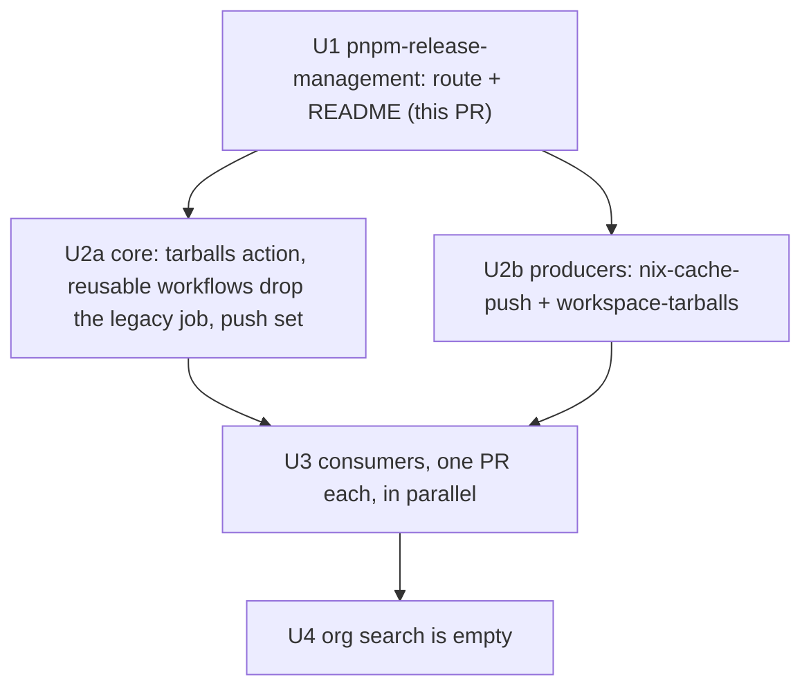

# Consumers take @systemfsoftware tarballs from the Nix cache - Plan

Notation: `{legacy}` stands for the characters `sfs`, a hyphen and `deps`, written together nowhere in this plan. SYS-1296's done-when is a code search for that word across the org, and this repository is in it.

## Goal Capsule

- **Objective:** A repository installs its `@systemfsoftware/*` packages without building any producer locally, and moving to a newer producer release is one flake-input bump.
- **Means:** consumers use pnpm-release-management's one documented route over the public cache (KTD1, KTD2).
- **Authority:** SYS-1296 (owner ruling 2026-11-11) over this plan; the plan over any repository's current layout.
- **Stop conditions:** this PR delivers U1 only. U2 to U4 are specified for the conductor to dispatch; nothing outside this repository is edited here.
- **Execution profile:** U1 inline in this repository; U2 to U4 are independent per-repository PRs.

---

## Product Contract

### Summary

Producers push their package tarballs to https://nix.systemfsoftware.com from `main`. A consumer pins each producer as a flake input, builds its install tree from the producers' `workspace-tarballs` (substituted, not built), and carries no per-repository tarball code.

### Problem Frame

Each of the 20 repositories in SYS-1296 hand-lists package names in a linkFarm, hand-keeps `file:.{legacy}/<name>-<version>.tgz` overrides, and copies tarballs into `.{legacy}/` with a script or a CI cache. Cold CI builds the producers (YOU-869: 518 derivations), and a stale fixed-output hash in one producer breaks all consumers (SYS-1295). npm still serves the 2026-10-06 versions, so the registry is not an option; the cache is the ruling.

### Requirements

**Consumer route (U1, this PR)**

- R1. A consumer names its producers (flake inputs) and no package. Every public member of each producer's `packages.<system>.workspace-tarballs` is available as `<package>.tgz`.
- R2. Tarball names carry no version, so the `file:` paths in manifests, overrides and lockfile never change when a producer releases; `pnpm install --update-checksums` records the new bytes.
- R3. The sandbox pnpm store and the consumer's own `workspace-tarballs` build take the same `producers`, so the sandbox holds registry packages and the producers' tarballs only.
- R4. A dev shell lays the tarballs where `pnpm install` reads them without a per-repository script; CI gets the same bytes from one exported package.
- R5. Two producers shipping one package, or a producer without `workspace-tarballs`, fail evaluation naming the cause.
- R6. The README says in one sentence that https://nix.systemfsoftware.com is the package registry for @systemfsoftware packages (producers push tarballs there from `main`, consumers substitute them through flake inputs, nothing goes to npm), and the consumer example shows the substituter and key beside the flake input. Code that existed only to feed the old per-repository route (`files`, `copyFiles`, the `.deps` fixtures) is deleted.

**Migration (U2 to U4)**

- R7. Every producer a consumer pins pushes `workspace-tarballs` for each system it builds, from `main`, signed by `nix-cache-1`.
- R8. Every repository in SYS-1296 drops all `{legacy}` code, docs and CI steps; `git grep -I {legacy}` is empty there.
- R9. In each consumer, `nix build --dry-run .#pnpm-store` with the cache as substituter lists no producer derivation as built, and the repository gate is green.
- R10. Every README, AGENTS.md and CONTRIBUTING.md that describes how @systemfsoftware packages are distributed or consumed carries the R6 sentence verbatim and no `{legacy}` instruction (SYS-1296 done-when).

### Scope Boundaries

- No npm publishing, trusted publishing or registry text (superseded by the owner's correction).
- The cache's own implementation (SYS-1283) and the producer push credentials (SYS-1260 owner steps) are not changed here.
- `release.yml` and the release tooling are untouched; no publishable package of this repository moved, so no changeset intent.

---

## Planning Contract

### Key Technical Decisions

- KTD1. **A producer is any flake exporting `packages.<system>.workspace-tarballs` with `members`.** `mkPnpmWorkspacePackages` already builds that output, with `members` as passthru. The consumer reads it at evaluation, so no name is listed and a member added upstream arrives on the next pin. Rejected: lockfile-driven selection (needs the tarballs before the first `pnpm install` can write a lockfile, and per-member store paths cost one substitution each).
- KTD2. **Stable names `<attr>.tgz`, not `<attr>-<version>.tgz`.** The ruling makes a version move one step; versioned names put the version in every override. stryker-js-effect already uses stable names. Checked with pnpm 11.27 and 12.9 on a scratch project: after the tarball bytes change, `pnpm install --update-checksums` rewrites the lockfile's integrity and `version`, while a plain frozen install refuses the mismatch. Consequence: two producers cannot ship one attr (R5), and a consumer needing two versions of a package cannot take both from producers (xstate and frontend's attw bootstrap, see U3).
- KTD3. **`workspace-tarballs` is the whole push set for a package consumer.** It is one store path per producer and system holding every member, and the consumer's link farm references it. Per-package outputs stay valid but are not required.
- KTD4. **`tarballsDir` defaults to `.tarballs`.** The consumer's lockfile names the directory, so it is a parameter of the store and the workspace build; the dev-shell hook takes `dir`.
- KTD5. **Consumers export `packages.<system>.tarballs`.** CI builds it and copies it into `.tarballs/`. This avoids entering a dev shell in every CI job, and the dev-shell hook (`mkPnpmTarballsHook`) copies the same derivation, keyed by its store path.
- KTD6. **A producer's inputs are taken as locked.** A `follows` on a producer input changes its derivations, so the cache has no entry and the producer builds locally. billing and effect-endgame-starter-kit do this today.
- KTD7. **A macOS shell reads the Linux outputs** through `mkPnpmConsumerTarballs { system = "aarch64-linux"; }`. The tarballs rebuild bit-for-bit across systems (`compare-across-systems` in core's `nix.yml`), and only Linux is pushed.
- KTD8. **Consumers pin producers at commits whose main CI pushed.** The cache holds paths from #927 (5836bb1) onward for core; an older pin misses and builds. Each migration therefore bumps core and the other producers to a pushed commit, and reviews the version moves it brings.

### Sequencing

U2a and U2b are independent of each other. U3 repositories are independent of each other except where a consumer is also a producer; those PRs merge in the order U2b lists.

---

## Implementation Units

### U1. The consumer route in pnpm-release-management (this PR)

- **Goal:** R1 to R6.
- **Files:**
  - `nix/lib/consumer-tarballs.nix` (new): the link farm, `attr.tgz` names, duplicate and missing-output errors.
  - `nix/lib/pnpm-store.nix`: `files` and `copyFiles` become `tarballs`, `tarballsDir`, `copyTarballs`.
  - `nix/lib/pnpm-workspace-packages.nix`: `files` becomes `producers`, `tarballsDir`.
  - `flake.nix`: `lib.mkPnpmConsumerTarballs`, `lib.mkPnpmTarballsHook`, `lib.mkPnpmConsumerStore { producers; tarballsDir; }`; checks `consumer-tarballs`, `workspace-file-deps`, `workspace-lockfile-members`.
  - `nix/lib/fixtures/tiny-producer.nix` (new), `nix/lib/fixtures/*`, `nix/sandbox/tiny-consumer/*`, `nix/sandbox/proofs.nix`, `nix/sandbox/proofs.sh`: fixtures on `.tarballs/tiny-lib.tgz`.
  - `.github/workflows/sandbox.yml`: runs `consumer-tarballs`.
  - `README.md`: cache, consumer route, producer push.
- **Approach:** the producer's members are read at evaluation; a `linkFarm` of `"${workspace-tarballs}/${member.tarball}"` named `${attr}.tgz`. The store and workspace build copy them into src at `tarballsDir`. The hook copies only when `.tarballs/.source` differs from the farm's store path.
- **Test scenarios:**
  - A producer's member appears as `<attr>.tgz` with the producer's bytes.
  - The same producer twice fails evaluation.
  - The hook leaves a current copy untouched and replaces a stale one, from a subdirectory of the repository.
  - A workspace whose member depends on a `file:` tarball packs with `producers`.
  - A consumer installs frozen and offline in the sandbox from a store built with `producers`; a store without them fails.
- **Verification:** `nix build .#checks.<system>.{consumer-tarballs,workspace-file-deps,workspace-lockfile-members,workspace-globs,pnpm-lock-parser}`, `nix build .#sandbox-proofs && result/bin/sandbox-proofs`, `pnpm check:ci`.

### U2a. Core: the CI side of the route

Core is both the first producer and the owner of the reusable workflows every consumer calls.

| Where                                                                                                                                               | Today                                                                                                                  | Change                                                                                                                                                                   |
| --------------------------------------------------------------------------------------------------------------------------------------------------- | ---------------------------------------------------------------------------------------------------------------------- | ------------------------------------------------------------------------------------------------------------------------------------------------------------------------ |
| `.github/workflows/reusable-checks.yml`, `reusable-mutation.yml`, `reusable-commitlint.yml`                                                         | a `{legacy}` job per call, inputs `{legacy}-installable` and `{legacy}-runs-on`, restore steps in every installing job | delete the job and both inputs; each installing job runs the new action below before `pnpm install`                                                                      |
| `.github/actions/{legacy}`, `.github/actions/{legacy}-restore`                                                                                      | cache key over lockfile integrities, build, verify                                                                     | delete; add `.github/actions/tarballs`: install Nix with the cache substituter, `nix build --no-link --print-out-paths .#tarballs`, copy into `.tarballs/` (input `dir`) |
| `.github/actions/sfs-tools`, `scripts/tools/{legacy}.ts` and its test                                                                               | the Deno tool                                                                                                          | delete the tool and its `tool` line                                                                                                                                      |
| `.github/actions/failure-summary/action.yml`                                                                                                        | four `{legacy}-*` reasons                                                                                              | replace with `tarballs-missing` (no `.#tarballs`)                                                                                                                        |
| `.github/consumer-fixture/*` and `consumer-fixture.yml`                                                                                             | a fixture lockfile on `file:.{legacy}/...`                                                                             | rewrite on `producers = [ stryker-js-effect ]`, `.tarballs/` paths; delete the job-name assertions on the legacy job                                                     |
| `.github/AGENTS.md`, `.changeset/README.md`, `CONCEPTS.md`                                                                                          | document the legacy flow                                                                                               | rewrite for the route                                                                                                                                                    |
| `flake.nix` `lib.mkConsumerStore { dir ? ".{legacy}" }`, `nix/consumer-load-check`, `nix/consumer-store-check.nix`, `nix/schema-law-consumer-check` | build consumers from `file:.{legacy}/<attr>-<version>.tgz`                                                             | `dir = ".tarballs"`, `file:.tarballs/<attr>.tgz`                                                                                                                         |
| `.github/workflows/nix-cache-push.yml`                                                                                                              | hand-listed `PUSH_SET` of 24 package attrs plus tools                                                                  | keep `workspace-tarballs`; drop the per-package attrs                                                                                                                    |

The reusable workflows are pinned by SHA in every caller, so U3 PRs bump that SHA as part of the migration.

### U2b. Producers other than core push `workspace-tarballs`

Each adds `.github/workflows/nix-cache-push.yml` (core's, with this repository's push set), a `nix-cache-push` environment restricted to `main`, and the credentials of SYS-1260 owner step 2. The push set for a package producer is `workspace-tarballs` for `x86_64-linux` and `aarch64-linux`, plus the repository's dev shell and tools if its own CI wants hits.

| Producer                                                                                                           | Public members consumers install                                                                                                                            | Also needs                                                                                                                  |
| ------------------------------------------------------------------------------------------------------------------ | ----------------------------------------------------------------------------------------------------------------------------------------------------------- | --------------------------------------------------------------------------------------------------------------------------- |
| systemfsoftware                                                                                                    | 30, including effect-cell-types, oxlint-*, vitest, tsconfig, tsdown-config, stryker-config, conformance-spec, trace-spec, omp-typescript-discipline         | done in #927; U2a trims the list                                                                                            |
| stryker-js-effect                                                                                                  | stryker-js, stryker-js-* (instrumenter, vitest-runner, typescript-checker, plugin-_, cli-contract, html-reporter), stryker-ignorer-_, oxlint-ignorer-config | SYS-1260 producer PR in flight                                                                                              |
| xstate                                                                                                             | xstate, xstate-effect, xstate-react, xstate-store, xstate-store-react, xstate-test                                                                          | SYS-1260 producer PR in flight                                                                                              |
| frontend                                                                                                           | effect-atom, effect-atom-react, storybook-gherkin, oxlint-config-frontend                                                                                   | core ships the first three too (SYS-439); the duplicate fails evaluation, so core drops them before any consumer takes both |
| effect-e2e                                                                                                         | effect-e2e, effect-e2e-cli, effect-e2e-web                                                                                                                  |                                                                                                                             |
| effect-daemon                                                                                                      | effect-daemon-cluster, -conformance, -process, -socket, -spec                                                                                               |                                                                                                                             |
| effect-microvm                                                                                                     | effect-daemon-microvm, effect-microsandbox                                                                                                                  |                                                                                                                             |
| effect-memfs, effect-readiness, hex-schema (effect-schema-extensions, hex-schema), npm-package, rx-effect, discern | one or two packages each                                                                                                                                    |                                                                                                                             |
| are-the-types-wrong-effect                                                                                         | arethetypeswrong-cli                                                                                                                                        | not in SYS-1296; its flake exports `attw` but no `workspace-tarballs`; adopt `mkPnpmWorkspacePackages` for it, then push    |
| pnpm-release-management                                                                                            | none consumed as tarballs                                                                                                                                   | SYS-1260 producer PR pushes `release-tools`, `sandbox`, `dprint`                                                            |

Consumers that are also producers (frontend, effect-daemon, effect-microvm, npm-package, discern, hex-schema and the rest) build their own `workspace-tarballs` with `producers` in `mkPnpmWorkspacePackages`, so their U3 and U2b PRs touch the same `flake.nix`; one PR per repository covers both.

### U3. Consumers, one PR each

Every consumer PR does the same four things, then the repository-specific work below.

1. `flake.nix`: add `nixConfig` (`extra-substituters`, `extra-trusted-public-keys = nix-cache-1:wXA8I4DayNW9q6enUyQA/P/nT38pGSTLt374t3gsn7M=`, `fallback = true`); pin each producer at a pushed `main` commit with no `follows` on its inputs (KTD6, KTD8); delete the hand-listed link farm and the `{legacy}` output; add `packages.tarballs = pnpm-release-management.lib.mkPnpmConsumerTarballs { inherit pkgs producers; }`, pass `producers` to `mkPnpmConsumerStore` and `mkPnpmWorkspacePackages`, and put `mkPnpmTarballsHook` in the dev shell.
2. `pnpm-workspace.yaml` and `package.json`: rewrite every `file:.{legacy}/<name>-<version>.tgz` to `file:.tarballs/<name>.tgz`; run `pnpm install --update-checksums` for the lockfile.
3. `.gitignore`, `dprint.json`: `.{legacy}/` becomes `.tarballs/`.
4. Docs and CI: delete the `cp -L` commands and cache steps from `AGENTS.md`, `CONTRIBUTING.md`, `README.md` and workflows; callers of core's reusable workflows bump the SHA and drop `{legacy}-installable`.
5. Docs sentence (R10): in each file listed under the repository's entry in the table below, remove every `{legacy}` instruction and put this sentence where distribution or consumption is described, replacing "from the core flake's tarballs, never a registry"-style wording: **https://nix.systemfsoftware.com is the package registry for @systemfsoftware packages: producers push package tarballs there from `main`, consumers substitute them through flake inputs, and nothing goes to npm.** Instructions that told a reader to rebuild `{legacy}` become "bump the producer input, then `pnpm install --update-checksums`". A producer's own README states the same sentence once in its install section.

Check: `git grep -I {legacy}` exits 1; `nix build --dry-run .#pnpm-store` with the cache as substituter lists no producer derivation; the gate is green; each file below carries the sentence.

**Documentation lines per repository.** `legacy` lines name the old route and are deleted or rewritten; `distribution` lines mention tarballs, a registry or a flake distribution and are read and aligned with the sentence. Line numbers are at each repository's `main` on 2026-11-11. Files under `docs/` and changelogs are reworded in the same PR when `git grep -I {legacy}` finds them (U4).

| Repository                  | File                                                                                                                           | legacy                                                                    | distribution                                                  |
| --------------------------- | ------------------------------------------------------------------------------------------------------------------------------ | ------------------------------------------------------------------------- | ------------------------------------------------------------- |
| api-extractor-effect        | `AGENTS.md`                                                                                                                    | 28                                                                        |                                                               |
|                             | `README.md`                                                                                                                    | 19, 164                                                                   | 162, 163                                                      |
| billing                     | `README.md`                                                                                                                    | 129                                                                       |                                                               |
| discern                     | `AGENTS.md`                                                                                                                    | 16, 17, 19, 24                                                            | 9, 15                                                         |
|                             | `CONTRIBUTING.md`                                                                                                              | 14, 19                                                                    | 7, 16                                                         |
| effect-daemon               | `AGENTS.md`                                                                                                                    | 22, 23, 25, 30                                                            | 9, 21                                                         |
|                             | `CONTRIBUTING.md`                                                                                                              | 16, 17, 22, 32                                                            | 15, 27                                                        |
|                             | `README.md`                                                                                                                    |                                                                           | 11, 22                                                        |
| effect-e2e                  | `AGENTS.md`                                                                                                                    | 19, 20, 22, 27                                                            | 9, 18                                                         |
|                             | `CONTRIBUTING.md`                                                                                                              | 6, 7, 14, 23                                                              | 5, 17                                                         |
|                             | `README.md`, `packages/effect-e2e/README.md`                                                                                   | 20, 20                                                                    | 14, 16                                                        |
|                             | `packages/effect-e2e-cli/README.md`, `packages/effect-e2e-web/README.md`                                                       |                                                                           | 7, 7                                                          |
| effect-endgame-starter-kit  | `README.md`                                                                                                                    | 128                                                                       |                                                               |
| effect-memfs                | `AGENTS.md`                                                                                                                    | 19, 20, 22, 27                                                            | 9, 18                                                         |
|                             | `CONTRIBUTING.md`                                                                                                              | 16                                                                        |                                                               |
|                             | `README.md`                                                                                                                    |                                                                           | 53                                                            |
| effect-microvm              | `AGENTS.md`                                                                                                                    | 20, 21, 23, 28                                                            | 9, 15, 19                                                     |
|                             | `packages/microvm-test-images/README.md`                                                                                       |                                                                           | 13                                                            |
| effect-readiness            | `AGENTS.md`                                                                                                                    | 16, 17, 19, 24                                                            | 9, 15                                                         |
|                             | `CONTRIBUTING.md`                                                                                                              | 12                                                                        | 16                                                            |
|                             | `README.md`                                                                                                                    |                                                                           | 7                                                             |
| frontend                    | `README.md`                                                                                                                    |                                                                           | 129                                                           |
|                             | `packages/atom/effect-atom-react/README.md`                                                                                    |                                                                           | 45, 49                                                        |
| hex-schema                  | `AGENTS.md`                                                                                                                    | 17, 18, 20, 25                                                            | 9, 11, 12, 16                                                 |
|                             | `CONTRIBUTING.md`                                                                                                              | 18, 19, 24, 34                                                            | 17, 29                                                        |
|                             | `README.md`                                                                                                                    |                                                                           | 16                                                            |
| npm-package                 | `AGENTS.md`                                                                                                                    | 18, 19, 21, 26                                                            | 3, 9, 17                                                      |
|                             | `CONTRIBUTING.md`                                                                                                              | 16, 17, 22, 32                                                            | 15, 27                                                        |
|                             | `README.md`, `packages/npm-package/README.md`                                                                                  |                                                                           | 3, 7, 15 and 3, 28, 43, 46, 49, 50                            |
| rx-effect                   | `AGENTS.md`                                                                                                                    | 16, 17, 19, 24                                                            | 9, 15                                                         |
|                             | `CONTRIBUTING.md`                                                                                                              | 16, 17, 22, 32                                                            | 15, 27                                                        |
|                             | `README.md`                                                                                                                    |                                                                           | 15                                                            |
| stryker-js-effect           | `AGENTS.md`                                                                                                                    | 8, 31                                                                     |                                                               |
|                             | `packages/stryker-js/tests/__fixtures__/lockfile-closure/README.md`                                                            |                                                                           | 16, 19, 28                                                    |
|                             | `packages/stryker-js-instrumenter/README.md`, `test/e2e/README.md`, `test/e2e/AGENTS.md`, `test/bench/README.md`               |                                                                           | 19; 12, 14, 42; 19; 13                                        |
| systemfsoftware             | `.github/AGENTS.md`                                                                                                            | 22, 31, 35, 37, 39, 45, 70, 80, 97, 107                                   | 25 (states "There is no registry"; replace with the sentence) |
|                             | `AGENTS.md`, `CONTRIBUTING.md`, `README.md`, `CONCEPTS.md`                                                                     |                                                                           | 52, 71; 7, 48, 50, 51; 324, 342; 225                          |
|                             | `packages/toolchain/{stryker-config,tsdown-config,vitest-config}/README.md`                                                    |                                                                           | 7; 9; 7, 13                                                   |
| turbo-remote-cache          | `README.md`                                                                                                                    | 58                                                                        | 56, 61                                                        |
|                             | `CLOSURE.md` (not one of the three)                                                                                            | 27, 28, 124                                                               |                                                               |
| xstate                      | `AGENTS.md`                                                                                                                    |                                                                           | 25                                                            |
|                             | `CONTRIBUTING.md`                                                                                                              |                                                                           | 50, 51                                                        |
|                             | `README.md`, `compound-packs/xstate/README.md`                                                                                 |                                                                           | 15, 18, 19, 22, 28; 3                                         |
| younna-ai                   | `CONTRIBUTING.md`                                                                                                              | 5                                                                         |                                                               |
|                             | `CONCEPTS.md`                                                                                                                  |                                                                           | 25, 27, 31                                                    |
|                             | `tooling/lockfile/README.md`                                                                                                   | 9, 19, 21, 23, 24, 29, 30, 32, 34, 35, 53, 61, 62, 64, 67, 69, 72, 79, 81 | 38, 44                                                        |
| agent-inbox, polymarket-bot | no README, AGENTS.md or CONTRIBUTING.md line; agent-inbox's `.kiro/specs/kiro-inbox-iac/plan.md` (six references) is rewritten |                                                                           |                                                               |

younna-ai's `workers/registry` and `tooling/registry-publish` document its application registry, not package distribution, and are unchanged. nix-cache's own README (SYS-1296's third docs requirement) names the cache as the registry for workspace packages in its own PR, in that repository.

**Group A: core-only consumers with the shared template.** discern, effect-daemon, effect-e2e, effect-memfs, effect-microvm, effect-readiness, hex-schema, npm-package, rx-effect.

- Pins: `core` at `31963d5a` (before #927; bump).
- Machinery: `flake.nix` lines 6 to 59 (a `sfsPackages` map of 22 to 24 names, `producers`, `sfsDepsOf` link farm, `files.".{legacy}"`); 17 to 27 overrides in `pnpm-workspace.yaml`; `.gitignore:19-20`; `dprint.json:20`; `AGENTS.md`, `CONTRIBUTING.md` and in effect-e2e `README.md:20`, `packages/effect-e2e/README.md:20`; `.github/workflows/ci.yml:63-64` in effect-microvm. CI in the others reaches the machinery through core's reusable default installable.
- Replacement: step 1 to 4 with `producers = [ core ]`; effect-daemon, effect-microvm and npm-package also name tarballs of effect-readiness, effect-daemon and effect-memfs. Those repositories are their own producers now, so each is added as an input unless core's pushed commit still ships the package; a package no producer ships fails the install, and the PR lists which producer serves each.
- Pushes needed: core; plus effect-readiness, effect-daemon, effect-memfs for the three that consume them.

**Group B: three-producer consumers with `jq`-merged farms.** billing (private), effect-endgame-starter-kit, polymarket-bot (private).

- Pins: `systemfsoftware`, `stryker-js-effect`, `xstate` on `main`; billing and effect-endgame-starter-kit give each `inputs.nixpkgs.follows` and `comment-checker.follows` (cache misses).
- Machinery: `flake.nix` `{legacy}` derivation merging each input's `index.json` (billing 55 to 77, effect-endgame-starter-kit 65 to 83, polymarket-bot 54 to 68); `files.".{legacy}"`; overrides in `pnpm-workspace.yaml` (37 entries) and polymarket-bot's `package.json` (38 entries); `scripts/check-sfs-sources.ts` messages; `sandbox-proofs/git-hooks.test.ts:75-77` copying `.{legacy}` into a worktree; README step 9 in billing and effect-endgame-starter-kit; polymarket-bot `.github/actions/{legacy}/action.yml` wrapping core's actions and `check.yml:45`.
- Replacement: `producers = [ core stryker-js-effect xstate ]`; drop the `follows`; the git-hooks test copies `.tarballs`; `check-sources` keeps its job (no `@systemfsoftware/*` from npm, whose copies are stale) with new wording.
- Pushes needed: core, stryker-js-effect, xstate.

**api-extractor-effect.** Pins `systemfsoftware` (`732f66a`), `stryker-published` (stryker-js-effect `27b1075`), `are-the-types-wrong-effect`, `pnpm-release-management` (`b9b4a1d`). Machinery: `flake.nix` link farm (lines 34 to 100, 34 names), `.github/workflows/ci.yml:22-44` (a `{legacy}` job, cache path, `cp -rL`), `.github/actions/checks-lane/action.yml:32-33`, `changeset-check.yml:15`, `.gitignore:5-6`, `AGENTS.md:28`, `README.md:19,164`, overrides (35 entries). Replacement: `producers = [ systemfsoftware stryker-js-effect ]`; CI uses the `tarballs` action; `release.yml` already calls the shared workflow. Pushes: core, stryker-js-effect.

**frontend** (producer and consumer). Pins `systemfsoftware` (`d1ab631`, and a second at `4cf0f77`), `stryker-js-effect/main`, `xstate/main`, `are-the-types-wrong-effect`. Machinery: `flake.nix` (`sys-tarballs`, a `for dir in` copy loop, `attw.tarballs` at 148), `nix/from-source.nix`, `nix/pnpm-store.nix` (a local store builder taking `".{legacy}"`), `nix/attw/` and `nix/effect-cell-types/` sub-workspaces on `file:.{legacy}/effect-cell-types-7.0.0.tgz`, `pnpm-workspace.yaml` (49 entries), `scripts/check-sfs-sources.ts`, `sandbox-proofs/git-hooks.test.ts`, `release.jsonc`, `.changeset/README.md`. Replacement: `producers = [ systemfsoftware stryker-js-effect xstate are-the-types-wrong-effect ]`; delete `nix/from-source.nix`, `nix/pnpm-store.nix`, `nix/attw`, `nix/effect-cell-types`. The attw bootstrap needs effect-cell-types 7.0.0 beside the workspace's 12.x, which stable names cannot carry; it disappears because attw becomes a producer built by its own flake (U2b). Pushes: core, stryker-js-effect, xstate, are-the-types-wrong-effect.

**xstate** (producer and consumer). Pins `systemfsoftware` (`217c80d`, `4cf0f77`), `stryker-js-effect` (`3db0c42`, `flake = false`), `are-the-types-wrong-effect` (`flake = false`), `systemfsoftware-effect-cell-types-7`, `pnpm-release-management` (three pins), `release-tools`. Machinery: `flake.nix:27,86,103,125` (`{legacy}` binding, `deps = {legacy}`), `nix/from-source.nix`, `nix/pnpm-store.nix:20`, `nix/attw`, `nix/effect-cell-types`, `nix/stryker-js` (18 overrides on `.{legacy}`), `pnpm-workspace.yaml` (35 entries), `.github/workflows/ci.yml:61`, `.gitignore:15`, `sandbox-proofs/git-hooks.test.ts:52-54`. Replacement: `stryker-js-effect` and `are-the-types-wrong-effect` become normal flake inputs (not `flake = false`) in `producers`; the three source builds, `nix/pnpm-store.nix` and the extra `pnpm-release-management` pins go; one pin of this PR's merge remains. Pushes: core, stryker-js-effect, are-the-types-wrong-effect. xstate's own `workspace-tarballs` push (U2b) is a prerequisite for billing, polymarket-bot, effect-endgame-starter-kit, frontend.

**stryker-js-effect** (producer and consumer). Pins `systemfsoftware`, `stryker-published` (its own previous release commit), `gritlint`, `pnpm-release-management`. Machinery: `flake.nix:52-65,124` (`publishedOf` link farm, `files.".{legacy}"`), `.github/actions/released-tarballs/action.yml`, `.github/workflows/{bench,ci}.yml` (`ci.yml:494-498`), `.gitignore:18-19`, `AGENTS.md` (START-6), `packages/*/package.json` and `test/e2e-core/package.json` (about 20 `file:../../.{legacy}/<name>.tgz` entries, already stable-named), `pnpm-workspace.yaml` (18). Product code and fixtures also name the path: `packages/stryker-js/src/pnpm-lock.schema.ts:119-130` and two captured lockfiles under `packages/stryker-js/tests/__fixtures__/lockfile-closure/real/` (114 hits each); the fixtures are captured real lockfiles, so they are re-captured from the migrated repository, not edited. Replacement: `producers = [ stryker-published ]` (a flake input at the last release commit) for dogfood, `.tarballs/` paths; core as producer for config packages. Pushes: core, stryker-js-effect (own, for the next release's dogfood).

**systemfsoftware** (core). U2a above; core consumes `stryker-js-effect` only in its consumer fixture.

**younna-ai** (private). Pins `systemfsoftware`, `frontend`, `effect-e2e` (inputs not followed), `gritlint`, `comment-checker`; lockfile also names tarballs of discern, effect-daemon, effect-microvm, effect-memfs, hex-schema, npm-package, effect-readiness, rx-effect (`flake.nix:55-75`: `linksOf` with first-input-wins). Machinery: `flake.nix` `{legacy}` farm and dev-shell hook calling `scripts/{legacy}`; `scripts/{legacy}`; the `tooling/lockfile` package (`{legacy}` copy, key and verify commands, `tarball-demand.ts`, `{legacy}-copy.ts`, merge driver and `verify-lockfile.ts` hooks, `lockfile.schema.ts`, README, exit codes 3 to 7); `.github/actions/{legacy}`, `setup-workspace`, `accessibility.yml:40`, `ci.yml:73-75`, `registry-publish.yml:67-68`, `turbo-cache.yml:48`, `commitlint.yml:34`, `deploy.yml:41`; `packages/app-packager/Dockerfile:15` (`COPY .{legacy}`), `workers/platform/src/stacks/app-packager-image-context.ts:13`; `CONTRIBUTING.md:5`; `.gitignore:12-13`; `pnpm-workspace.yaml` (82 entries); pnpm 12.6.0 via corepack. Replacement: `producers` = the producers above, with one name per package (first-wins is gone, so the effect-atom, effect-atom-react and storybook-gherkin overlap between core and frontend must be removed first, SYS-439); `mkPnpmTarballsHook` with `system = "aarch64-linux"` on macOS; delete `scripts/{legacy}` and the tarball parts of `tooling/lockfile`, keeping its merge driver and verify command for the lockfile itself; Dockerfile and image context use `.tarballs`. Pushes: core, frontend, effect-e2e, effect-daemon, effect-microvm, effect-memfs, hex-schema, npm-package, effect-readiness, rx-effect, discern.

**agent-inbox** (private, no flake, pnpm 11.21). Machinery: nine tarballs committed under `.{legacy}/`, `pnpm-workspace.yaml:19-26` (11 lines), `.kiro/specs/kiro-inbox-iac/plan.md` (six references). Replacement: add a `flake.nix` with `core` as producer, `packages.tarballs`, a dev shell with the hook and `nixConfig`; delete the committed tarballs; rewrite the plan references. Pushes: core.

**turbo-remote-cache** (private, no flake). Machinery: ten tarballs tracked in git, `package.json:23-24`, `CLOSURE.md:27,28,124`, `README.md:58`. Replacement as agent-inbox, with `oxlint-config-recommended` and `tsconfig` from core. Pushes: core.

### U4. The org search

After every U3 PR merges, `gh search code --owner systemfsoftware {legacy}` returns nothing outside history. Search indexes the default branch, so changelogs, `docs/plans`, `docs/brainstorms` and `docs/solutions` that mention the legacy name are reworded in the PR that migrates their repository, not left as history.

---

## Verification Contract

| Applies to | Command                                                                                                                                         | Proves                                                                   |
| ---------- | ----------------------------------------------------------------------------------------------------------------------------------------------- | ------------------------------------------------------------------------ |
| U1         | `nix build .#checks.<system>.consumer-tarballs`, `.workspace-file-deps`, `.workspace-lockfile-members`, `.workspace-globs`, `.pnpm-lock-parser` | R1, R2, R3, R5                                                           |
| U1         | `nix build .#sandbox-proofs && result/bin/sandbox-proofs`                                                                                       | consumer installs frozen and offline; a store without the tarballs fails |
| U1         | `pnpm check:ci`                                                                                                                                 | gate                                                                     |
| U2b        | `nix build .#packages.<system>.workspace-tarballs` then a consumer's `nix build --dry-run`                                                      | the push covers what consumers evaluate                                  |
| U3         | `git grep -I {legacy}`; `nix build --dry-run .#pnpm-store` with the cache; the repository gate                                                  | R8, R9                                                                   |
| U4         | `gh search code --owner systemfsoftware {legacy}`                                                                                               | SYS-1296 done-when                                                       |

## Definition of Done

- U1: the PR is open with the gate exit 0, no `files`/`copyFiles`/`.deps` left in the repository, README describing the cache and the route.
- U2 to U4: the three SYS-1296 done-when lines hold, by the commands above.
- No scaffolding from the route's development remains in any diff.

## Risks & Dependencies

- Version moves: a pushed core commit ships newer majors than the pins above (oxlint-config-* 6, vitest 4, effect-cell-types 12.1); each consumer PR reviews what the bump changes.
- Duplicate packages across core and frontend block younna-ai until SYS-439 lands.
- A first-time producer push needs the SYS-1260 owner steps (environment, Doppler sync) per repository.
- Private consumers' CI reads public producers; no fetch token is needed for the cache.
- Evidence limit: nothing here ran against the real cache; U1's checks use a fixture producer.
